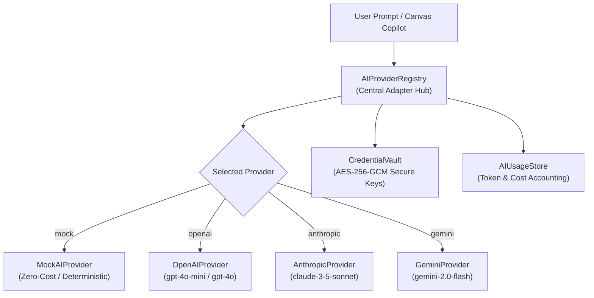

# FlowPilot AI Provider Architecture

## 1. Overview

FlowPilot implements a pluggable, decoupled AI Provider abstraction layer enabling seamless orchestration across multi-vendor Large Language Models.



---

## 2. Core Components

1. **`AIProviderAdapter` Interface (`src/core/ai/types.ts`)**:
   Standardized contract implemented by all model adapters:
   - `getModels(): AIModelInfo[]`
   - `getDefaultModel(): string`
   - `testConnection(apiKey?: string): Promise<{ success: boolean; message: string; latencyMs: number }>`
   - `chat(messages: AIMessage[], options?: AIChatOptions, apiKey?: string): Promise<AIChatResponse>`

2. **`BaseAIProvider` (`src/core/ai/providers/baseProvider.ts`)**:
   - Secret Redaction: Strips API keys, passwords, bearer tokens, and webhook secrets from outgoing prompt text.
   - Timeout and Abort Signal: Protects system event loops with configurable request timeouts (default: 45s).
   - Cost Accounting: Calculates real-time dollar costs per model based on input/output token pricing tables.
   - Clean JSON Parsing: Automatically strips markdown fences (````json ... ````) into validated JSON objects.

3. **`AIProviderRegistry` (`src/core/ai/aiProviderRegistry.ts`)**:
   - Singleton managing registered providers.
   - Retrieves encrypted credentials securely from `CredentialVault` without ever leaking secrets to the client.
   - Dynamically selects active provider and model via REST API (`PATCH /api/v1/ai/providers`).

---

## 3. Supported Model Catalog

| Provider | Model ID | Context Window | Input Cost / 1k | Output Cost / 1k |
| :--- | :--- | :--- | :--- | :--- |
| **Google Gemini** | `gemini-2.0-flash` (default) | 1,048,576 tokens | $0.00010 | $0.00040 |
| **Google Gemini** | `gemini-1.5-pro` | 2,097,152 tokens | $0.00125 | $0.00500 |
| **OpenAI** | `gpt-4o-mini` (default) | 128,000 tokens | $0.00015 | $0.00060 |
| **OpenAI** | `gpt-4o` | 128,000 tokens | $0.00250 | $0.01000 |
| **Anthropic** | `claude-3-5-sonnet-latest` | 200,000 tokens | $0.00300 | $0.01500 |
| **Anthropic** | `claude-3-haiku-20240307` | 200,000 tokens | $0.00025 | $0.00125 |
| **FlowPilot Mock** | `flowpilot-mock-v1` | 128,000 tokens | $0.00000 | $0.00000 |

