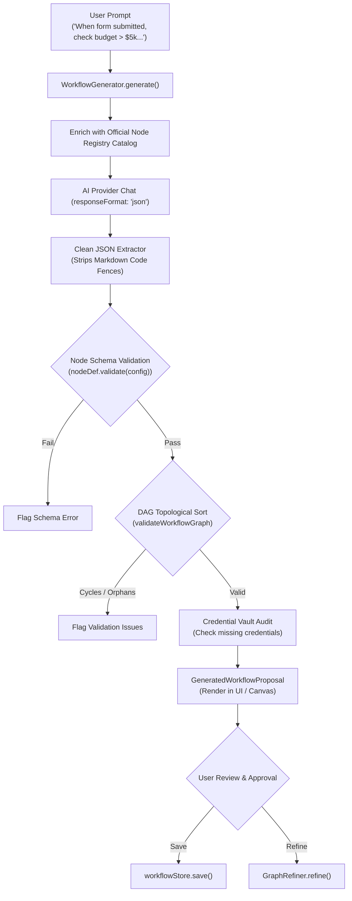

# FlowPilot Natural Language Workflow Generation & Registry Validation

## 1. Overview

FlowPilot enables users to convert natural language descriptions into production-ready visual automation DAGs. The engine guarantees that all generated workflows:
1. Use only officially registered node types from `NODE_REGISTRY`.
2. Pass strict topological DAG validation (Kahn's Algorithm, single trigger root, acyclic graph, valid handle routing).
3. Undergo integration audits to flag missing API credentials before activation.
4. Require explicit user review and confirmation before persisting to the database.

---

## 2. Architecture & Pipeline

---

## 3. Strict Validation Guardrails

- **Zero-Hallucination Node Types:** Every node type returned by the LLM is checked via `getNodeDefinition(node.type)`. If unregistered, generation flags `UNKNOWN_NODE_TYPE`.
- **Zod Config Enforcement:** Node configurations are verified against their registered Zod schemas (`configSchema.safeParse(config)`).
- **DAG Integrity:** `validateWorkflowGraph()` ensures the graph contains at least one trigger node, has no cycles, and edges link to valid port handles (`true`, `false`, `default`).
- **Credential Dependency Verification:** If a generated workflow includes nodes requiring external services (`slack`, `google_sheets`, `smtp`, `telegram`), the system queries `credentialStore.listSync()` and issues prominent warnings if active credentials do not exist.
