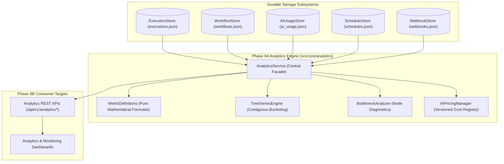

# FlowPilot: Analytics Data Architecture & Aggregation Layer (Phase 9A)

## 1. System Overview

Phase 9A establishes FlowPilot's headless Analytics & Monitoring Aggregation Layer. It ingests telemetry directly from actual storage subsystems, performs rigorous statistical normalization, and surfaces high-precision metrics to downstream presentation layers (Phase 9B).

---

## 2. Core Architectural Guarantees

### 2.1. Zero Fabrication Policy
FlowPilot strictly forbids returning mock, simulated, or default placeholder metrics for production entities.
- If a workspace has 0 executions in a reporting window, `successRate` and `failureRate` return `{ value: null, formatted: "N/A", sampleSize: 0, isAvailable: false }`.
- Unknown or uninstrumented AI models return `costUsd: null` with `isAvailable: false`. Costs are never assumed to be zero.

### 2.2. Strict Tenant Isolation
All aggregation queries require an explicit `workspaceId`. Executions, AI tokens, schedules, and webhooks belonging to other workspaces are filtered out at the store query boundary.

### 2.3. Division-by-Zero Protection
All rate calculations verify that the denominator is strictly non-zero before division. Terminal executions are defined as $N_{\text{COMPLETED}} + N_{\text{FAILED}}$. In-flight and cancelled runs do not pollute the denominator.

---

## 3. Subsystem Breakdown

### 3.1. Time-Series Engine (`src/core/analytics/timeSeries.ts`)
* **Interval Support:** Hourly (`hour`), Daily (`day`), Weekly (`week`), and Monthly (`month`).
* **Boundary Semantics:** Strict $[t_{\text{start}}, t_{\text{end}})$ (inclusive start, exclusive end).
* **Continuous Timeline Zero-Filling:** Unbroken sequences are generated for the entire query window. Periods with zero runs produce explicit zero-valued points (`total: 0, completed: 0, failed: 0, meanDurationMs: null`).

### 3.2. Bottleneck Diagnostics (`src/core/analytics/bottleneckAnalyzer.ts`)
* **Sample Size Threshold ($N \ge 5$):** Nodes with fewer than 5 recorded executions are flagged as `sampleSizeAdequate: false`. No warnings are emitted on sparse data.
* **Duration Contribution Warning:** Triggered if a node's mean duration accounts for $> 40\%$ of the parent workflow's mean duration. Supports parallel/loop workflows where contribution naturally exceeds $1.0$ (100%).
* **Failure Rate Warning:** Triggered if a node's failure rate exceeds $15.0\%$.
* **Ranking Score:** Weighted sorting index ($0.6 \times \text{DurationFactor} + 0.4 \times \text{FailureFactor}$) used strictly for ordering problematic nodes.

### 3.3. AI Pricing Manager (`src/core/analytics/pricing.ts`)
* **Versioned Registry:** Accommodates model price changes over time (e.g. `'2026-Q1'`).
* **Effective Date Resolution:** Historical calls resolve the pricing tier that was active on the date the inference occurred (`asOfDate`).
* **Dynamic Registration:** New models and updated pricing tiers can be registered at runtime without modifying core engine logic.

---

## 4. Platform Limitations & Boundary Notes

1. **Webhook Deliveries Buffer (500 Records):**
   `WebhookStore` retains up to 500 recent delivery records in its circular buffer. The integration health report explicitly documents this limitation.
2. **Scheduler Telemetry:**
   Scheduler metrics report confirmed schedules configured in `ScheduleStore`. Worker heartbeats and distributed queue depths require external Redis/BullMQ instrumentation (planned for Phase 10+).

