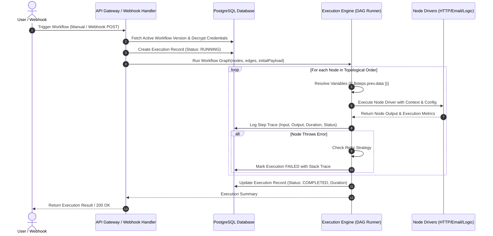

# FlowPilot — System Architecture & Technical Specification

> **Product:** FlowPilot  
> **Tagline:** Build workflows visually. Connect apps. Automate repetitive work.  
> **Repository:** [github.com/heyshahid/flowpilot](https://github.com/heyshahid/flowpilot)  
> **Document Status:** Architectural Baseline (Phase 1)  
> **Author & Architect:** Shahid Akram & Engineering Team  

---

## 1. Executive Summary & Vision

**FlowPilot** is an open-source, self-hostable, visual no-code workflow automation platform designed to empower teams, developers, and business operators to seamlessly connect applications, APIs, databases, and AI models into resilient, automated pipelines.

Unlike superficial workflow tools that merely animate UI nodes without true backend decoupling, **FlowPilot enforces a strict architectural boundary between visual design (the Canvas) and asynchronous execution (the Engine)**:

```
┌────────────────────────────────────────────────────────┐
│               VISUAL BUILDER (FRONTEND)                │
│  React Flow Canvas • Drag & Drop • Node Configuration  │
│  Real-Time Graph Validation • Expression Assistant     │
└───────────────────────────┬────────────────────────────┘
                            │ Serialized JSON DAG
                            ▼
┌────────────────────────────────────────────────────────┐
│             ORCHESTRATION & PERSISTENCE                │
│   Next.js API Routes • PostgreSQL Storage (Supabase)   │
│   Workflow Versioning • Webhook Ingestion Gateway      │
└───────────────────────────┬────────────────────────────┘
                            │ Job Dispatch / Events
                            ▼
┌────────────────────────────────────────────────────────┐
│            EXECUTION ENGINE (CORE RUNTIME)             │
│   Topological DAG Sorter • Node Context Resolver       │
│   SSRF Safety Layer • Retries & Error Handling         │
│   Node Drivers: HTTP, Webhook, Email, Logic, AI        │
└───────────────────────────┬────────────────────────────┘
                            │ Step-by-Step Traces
                            ▼
┌────────────────────────────────────────────────────────┐
│             AUDIT & EXECUTION LOGS VAULT               │
│   Node Inputs/Outputs • Duration • Error Stacks        │
│   Replay & Retry Subsystem • Real-time Monitoring      │
└────────────────────────────────────────────────────────┘
```

---

## 2. Core Architectural Pillars

### 2.1 Decoupled Execution & Representation
The visual canvas produces a **Directed Acyclic Graph (DAG)** representation composed of:
1. **Nodes (`WorkflowNode`):** Distinct processing units (Trigger, Action, Logic, Data, AI).
2. **Edges (`WorkflowEdge`):** Directed connections linking source handles to target handles.
3. **Configurations (`NodeConfig`):** Parameter maps validated against Zod schemas.

The Execution Engine treats this JSON representation as immutable input. It compiles the DAG into an execution plan via topological sorting (Kahn's Algorithm), detects cycles, resolves dynamic expressions (`{{ $steps.trigger_1.body.email }}`), and executes nodes sequentially or in parallel branches.

### 2.2 Security-First Execution (Zero-Trust Sandbox)
- **SSRF Immunity:** Outbound HTTP request nodes are guarded by an IP firewall interceptor that blocks private RFC 1918 subnets (`10.0.0.0/8`, `172.16.0.0/12`, `192.168.0.0/16`), loopbacks (`127.0.0.1`, `::1`), link-local (`169.254.0.0/16`), and AWS/GCP cloud metadata endpoints (`169.254.169.254`).
- **Encrypted Credential Vault:** API keys, SMTP passwords, and OAuth tokens are stored in the database using **AES-256-GCM** authenticated encryption with an environment-level master key (`FLOWPILOT_ENCRYPTION_KEY`). Secrets are never logged or exposed to the client browser.
- **Resource Constraints:** Strict timeouts per node execution (default 30 seconds), memory limits, and recursion guards prevent runaway execution or denial-of-service loops.

### 2.3 Self-Hostable & Scalable Cloud Ready
- **Phase 1-4 (Embedded Self-Hostable):** Zero-external-dependency operation. Runs locally with Next.js, SQLite/PostgreSQL, and built-in async worker queuing.
- **Phase 5+ (Distributed Enterprise):** Offloads workflow jobs to Redis/BullMQ with dedicated worker microservices, multi-tenant workspace isolation, and webhook load balancing.

---

## 3. Technology Stack Breakdown

| Layer | Selected Technology | Architectural Justification |
| :--- | :--- | :--- |
| **Frontend Framework** | **Next.js (App Router, React 19 / TypeScript)** | Server components for security, client components for high-interactivity canvas, unified full-stack API routes. |
| **Visual Workflow Canvas** | **React Flow (`@xyflow/react`)** | Industry-standard performant canvas library with customizable nodes, smooth zoom/pan, minimap, handles, and custom edges. |
| **UI Design System** | **Tailwind CSS + Radix UI + Lucide** | Minimal, modern technical SaaS aesthetic (Navy `#0F172A`, Blue `#2563EB`, Crisp light backgrounds `#F8FAFC`). |
| **State Management** | **Zustand + React Query** | Lightweight canvas state (undo/redo, node drag, edge connection) without heavy re-renders. |
| **Execution Runtime** | **Node.js (TypeScript Core Engine)** | Typed node contracts, native JSON handling, stream processing, asynchronous promises, and event emitters. |
| **Data Validation** | **Zod** | End-to-end type safety across API boundaries, node configuration forms, and execution contexts. |
| **Database & ORM** | **PostgreSQL (Supabase / Prisma)** | Relational rigor for workflows, executions, and credentials; JSONB columns for flexible node configuration schemas. |
| **Testing Suite** | **Vitest** | Blazing-fast unit and integration testing with ESM support for execution graph validation and node execution drivers. |

---

## 4. Subsystem Architecture

### 4.1 Visual Builder Subsystem
The visual builder provides a responsive desktop-first canvas:
- **Node Palette (Draggable Tray):** Categorized library (Triggers, Actions, Logic, Data, AI).
- **Interactive Canvas:** Grid background, snapping, connection line validation, multi-select, zoom/pan controls, minimap.
- **Node Configuration Drawer:** Contextual side drawer opening upon node selection. Renders dynamic schema-driven form fields with variable autocomplete (`{{ ... }}`).
- **Graph Validator:** Continuously evaluates graph integrity:
  - Must have exactly one active Trigger node.
  - No orphaned action nodes.
  - Cycle detection (prevents infinite loops before execution).
  - Required configuration fields completed.

### 4.2 Webhook Ingestion Subsystem
- **Endpoint:** `/api/v1/webhooks/[webhookId]`
- **Mechanism:** Listens for incoming HTTP POST/GET payloads.
- **Verification:** HMAC-SHA256 signature verification (optional secret header).
- **Dispatch:** Creates an execution record in `PENDING` state and invokes the execution worker asynchronously with payload `{ headers, query, body }`.

### 4.3 Node Registry & Driver Subsystem
Every node implements a standard polymorphic contract:

```typescript
export interface NodeDriver<TConfig, TInput, TOutput> {
  type: string;
  category: 'trigger' | 'action' | 'logic' | 'data' | 'ai';
  displayName: string;
  description: string;
  icon: string;
  configSchema: z.ZodSchema<TConfig>;
  execute(params: {
    config: TConfig;
    input: TInput;
    context: WorkflowExecutionContext;
  }): Promise<NodeExecutionResult<TOutput>>;
}
```

---

## 5. Directory Structure & Code Organization

```
flowpilot/
├── docs/                      # Architectural specifications & reports
│   ├── ARCHITECTURE.md        # This specification
│   ├── DATABASE_SCHEMA.md     # Relational database DDL & RLS
│   ├── EXECUTION_ENGINE.md    # Engine runtime, DAG, & SSRF specs
│   ├── NODE_SPECIFICATIONS.md # Standard node registry definitions
│   └── PHASE1_REPORT.md       # Phase 1 signoff and Phase 2 roadmap
├── src/
│   ├── app/                   # Next.js App Router (Pages & APIs)
│   │   ├── (dashboard)/       # Dashboard, Workflows, Settings layouts
│   │   ├── builder/[id]/      # Visual Workflow Editor route
│   │   ├── api/v1/            # Secure REST APIs (Workflows, Executions, Webhooks)
│   │   └── layout.tsx         # Root layout
│   ├── components/            # UI Components
│   │   ├── canvas/            # React Flow nodes, edges, controls, minimap
│   │   ├── panels/            # Node config drawer, variable picker, test runner
│   │   ├── layout/            # Sidebar, Header, Breadcrumbs, User menu
│   │   └── ui/                # Reusable design primitives (Button, Input, Badge, Dialog)
│   ├── core/                  # Decoupled Execution Engine (Pure TypeScript)
│   │   ├── engine/            # DAG runner, topological sort, variable resolver
│   │   ├── nodes/             # Standard node drivers (HTTP, Webhook, Email, IfElse, AI)
│   │   ├── security/          # SSRF guard, AES-256 vault, rate limiter
│   │   └── types/             # Common workflow, execution, and node types
│   └── lib/                   # Shared utilities (DB client, crypto, errors, formatters)
├── tests/                     # Automated Vitest test suite
│   ├── engine.test.ts         # DAG sorting, cycle detection, execution tests
│   ├── nodes.test.ts          # Node driver unit tests
│   └── ssrf.test.ts           # Security boundary & IP validation tests
├── package.json               # Dependencies and scripts
├── tsconfig.json              # TypeScript strict configuration
└── tailwind.config.ts         # Tailwind design system tokens
```

---

## 6. Execution Lifecycle & Data Flow



---

## 7. Phase 1 Architecture Verification Checklist

- [x] Clear decoupling between Canvas UI and Backend Execution Engine.
- [x] Zero-Trust SSRF mitigation and credential encryption planned.
- [x] PostgreSQL relational schema supporting Workspaces, Versions, and Executions.
- [x] Declarative JSON DAG structure with cycle prevention.
- [x] Modular node driver specification with Zod schema validation.
- [x] Extensible roadmap from single-process local MVP to distributed cloud worker queue.

