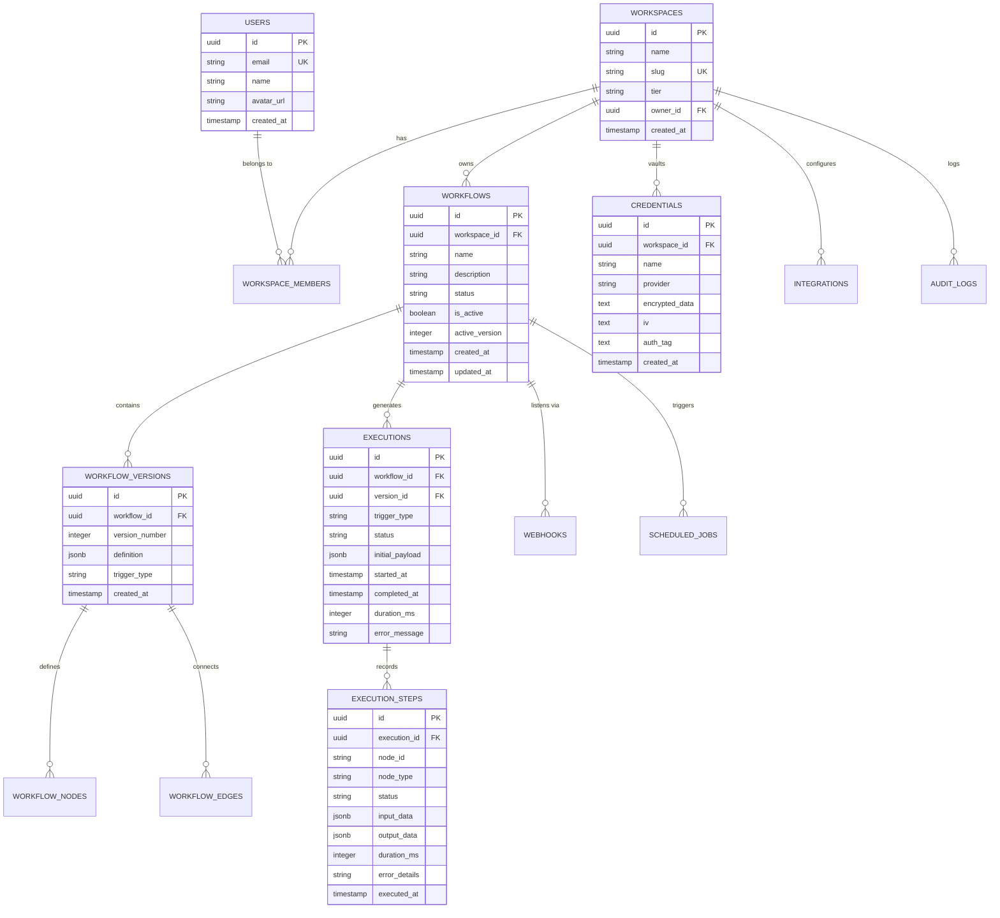

# FlowPilot — Relational Database Schema Specification

> **Platform:** FlowPilot Database Architecture  
> **Database:** PostgreSQL 15+ (Compatible with Supabase, AWS RDS, Neon, or Docker PostgreSQL)  
> **ORM Layer:** Prisma / Drizzle / Raw SQL Migrations  
> **Isolation Model:** Multi-Tenant Workspace Isolation with Row-Level Security (RLS)  

---

## 1. Entity-Relationship Overview



---

## 2. PostgreSQL DDL Specification

```sql
-- FlowPilot Production Database DDL
-- Extensions
CREATE EXTENSION IF NOT EXISTS "uuid-ossp";
CREATE EXTENSION IF NOT EXISTS "pgcrypto";

-- =============================================================================
-- 1. USERS & WORKSPACES (Multi-Tenancy)
-- =============================================================================
CREATE TABLE users (
    id UUID PRIMARY KEY DEFAULT uuid_generate_v4(),
    email VARCHAR(255) NOT NULL UNIQUE,
    name VARCHAR(255) NOT NULL,
    avatar_url TEXT,
    created_at TIMESTAMPTZ NOT NULL DEFAULT NOW(),
    updated_at TIMESTAMPTZ NOT NULL DEFAULT NOW()
);

CREATE TABLE workspaces (
    id UUID PRIMARY KEY DEFAULT uuid_generate_v4(),
    name VARCHAR(255) NOT NULL,
    slug VARCHAR(255) NOT NULL UNIQUE,
    tier VARCHAR(50) NOT NULL DEFAULT 'community', -- 'community', 'pro', 'enterprise'
    owner_id UUID NOT NULL REFERENCES users(id) ON DELETE RESTRICT,
    created_at TIMESTAMPTZ NOT NULL DEFAULT NOW(),
    updated_at TIMESTAMPTZ NOT NULL DEFAULT NOW()
);

CREATE TABLE workspace_members (
    id UUID PRIMARY KEY DEFAULT uuid_generate_v4(),
    workspace_id UUID NOT NULL REFERENCES workspaces(id) ON DELETE CASCADE,
    user_id UUID NOT NULL REFERENCES users(id) ON DELETE CASCADE,
    role VARCHAR(50) NOT NULL DEFAULT 'member', -- 'owner', 'admin', 'member', 'viewer'
    created_at TIMESTAMPTZ NOT NULL DEFAULT NOW(),
    UNIQUE (workspace_id, user_id)
);

-- =============================================================================
-- 2. CREDENTIAL VAULT (AES-256-GCM Encrypted)
-- =============================================================================
CREATE TABLE credentials (
    id UUID PRIMARY KEY DEFAULT uuid_generate_v4(),
    workspace_id UUID NOT NULL REFERENCES workspaces(id) ON DELETE CASCADE,
    name VARCHAR(255) NOT NULL,
    provider VARCHAR(100) NOT NULL, -- 'smtp', 'openai', 'custom_header', 'oauth2'
    encrypted_payload TEXT NOT NULL, -- Ciphertext in hex/base64
    iv VARCHAR(64) NOT NULL,         -- Initialization Vector
    auth_tag VARCHAR(64) NOT NULL,   -- GCM Authentication Tag
    masked_preview VARCHAR(255),     -- e.g. "sk-proj-...ab12"
    created_by UUID REFERENCES users(id) ON DELETE SET NULL,
    created_at TIMESTAMPTZ NOT NULL DEFAULT NOW(),
    updated_at TIMESTAMPTZ NOT NULL DEFAULT NOW()
);

CREATE INDEX idx_credentials_workspace ON credentials(workspace_id);

-- =============================================================================
-- 3. WORKFLOWS & VERSIONS
-- =============================================================================
CREATE TABLE workflows (
    id UUID PRIMARY KEY DEFAULT uuid_generate_v4(),
    workspace_id UUID NOT NULL REFERENCES workspaces(id) ON DELETE CASCADE,
    name VARCHAR(255) NOT NULL,
    description TEXT,
    status VARCHAR(50) NOT NULL DEFAULT 'draft', -- 'draft', 'active', 'paused', 'archived'
    is_active BOOLEAN NOT NULL DEFAULT FALSE,
    active_version_number INTEGER DEFAULT 1,
    created_by UUID REFERENCES users(id) ON DELETE SET NULL,
    created_at TIMESTAMPTZ NOT NULL DEFAULT NOW(),
    updated_at TIMESTAMPTZ NOT NULL DEFAULT NOW()
);

CREATE INDEX idx_workflows_workspace ON workflows(workspace_id);
CREATE INDEX idx_workflows_active ON workflows(workspace_id, is_active);

CREATE TABLE workflow_versions (
    id UUID PRIMARY KEY DEFAULT uuid_generate_v4(),
    workflow_id UUID NOT NULL REFERENCES workflows(id) ON DELETE CASCADE,
    version_number INTEGER NOT NULL,
    trigger_type VARCHAR(100) NOT NULL, -- 'trigger.manual', 'trigger.webhook', 'trigger.schedule'
    definition JSONB NOT NULL,          -- Complete React Flow DAG: { nodes: [], edges: [], viewport: {} }
    changelog TEXT,
    created_by UUID REFERENCES users(id) ON DELETE SET NULL,
    created_at TIMESTAMPTZ NOT NULL DEFAULT NOW(),
    UNIQUE (workflow_id, version_number)
);

CREATE INDEX idx_workflow_versions_lookup ON workflow_versions(workflow_id, version_number);

-- =============================================================================
-- 4. WEBHOOKS & SCHEDULES
-- =============================================================================
CREATE TABLE webhooks (
    id UUID PRIMARY KEY DEFAULT uuid_generate_v4(),
    workspace_id UUID NOT NULL REFERENCES workspaces(id) ON DELETE CASCADE,
    workflow_id UUID NOT NULL REFERENCES workflows(id) ON DELETE CASCADE,
    token VARCHAR(128) NOT NULL UNIQUE, -- Secure URL random token
    method VARCHAR(10) NOT NULL DEFAULT 'POST',
    secret_header VARCHAR(100),         -- e.g. 'X-FlowPilot-Secret'
    hashed_secret VARCHAR(255),        -- SHA-256 hash of secret value
    is_active BOOLEAN NOT NULL DEFAULT TRUE,
    created_at TIMESTAMPTZ NOT NULL DEFAULT NOW()
);

CREATE INDEX idx_webhooks_token ON webhooks(token);

CREATE TABLE scheduled_jobs (
    id UUID PRIMARY KEY DEFAULT uuid_generate_v4(),
    workspace_id UUID NOT NULL REFERENCES workspaces(id) ON DELETE CASCADE,
    workflow_id UUID NOT NULL REFERENCES workflows(id) ON DELETE CASCADE,
    cron_expression VARCHAR(100) NOT NULL, -- e.g. "0 9 * * 1-5" (Every weekday at 9am)
    timezone VARCHAR(100) NOT NULL DEFAULT 'UTC',
    is_active BOOLEAN NOT NULL DEFAULT TRUE,
    last_run_at TIMESTAMPTZ,
    next_run_at TIMESTAMPTZ,
    created_at TIMESTAMPTZ NOT NULL DEFAULT NOW()
);

-- =============================================================================
-- 5. EXECUTIONS & TRACING (Audit Logs)
-- =============================================================================
CREATE TABLE executions (
    id UUID PRIMARY KEY DEFAULT uuid_generate_v4(),
    workspace_id UUID NOT NULL REFERENCES workspaces(id) ON DELETE CASCADE,
    workflow_id UUID NOT NULL REFERENCES workflows(id) ON DELETE CASCADE,
    version_id UUID REFERENCES workflow_versions(id) ON DELETE SET NULL,
    trigger_type VARCHAR(100) NOT NULL,
    status VARCHAR(50) NOT NULL DEFAULT 'running', -- 'running', 'success', 'failed', 'cancelled'
    initial_payload JSONB,
    started_at TIMESTAMPTZ NOT NULL DEFAULT NOW(),
    completed_at TIMESTAMPTZ,
    duration_ms INTEGER,
    failed_node_id VARCHAR(100),
    error_message TEXT,
    retry_count INTEGER NOT NULL DEFAULT 0
);

CREATE INDEX idx_executions_workflow ON executions(workflow_id, started_at DESC);
CREATE INDEX idx_executions_workspace ON executions(workspace_id, started_at DESC);
CREATE INDEX idx_executions_status ON executions(status);

CREATE TABLE execution_steps (
    id UUID PRIMARY KEY DEFAULT uuid_generate_v4(),
    execution_id UUID NOT NULL REFERENCES executions(id) ON DELETE CASCADE,
    node_id VARCHAR(100) NOT NULL,
    node_type VARCHAR(100) NOT NULL,
    node_title VARCHAR(255) NOT NULL,
    status VARCHAR(50) NOT NULL, -- 'success', 'failed', 'skipped'
    input_data JSONB,
    output_data JSONB,
    duration_ms INTEGER NOT NULL DEFAULT 0,
    error_details TEXT,
    executed_at TIMESTAMPTZ NOT NULL DEFAULT NOW()
);

CREATE INDEX idx_execution_steps_exec ON execution_steps(execution_id, executed_at ASC);

-- =============================================================================
-- 6. TEMPLATES & AUDIT LOGS
-- =============================================================================
CREATE TABLE templates (
    id UUID PRIMARY KEY DEFAULT uuid_generate_v4(),
    name VARCHAR(255) NOT NULL,
    category VARCHAR(100) NOT NULL, -- 'marketing', 'crm', 'devops', 'ai'
    description TEXT NOT NULL,
    definition JSONB NOT NULL,
    required_integrations TEXT[] NOT NULL DEFAULT '{}',
    is_official BOOLEAN NOT NULL DEFAULT TRUE,
    created_at TIMESTAMPTZ NOT NULL DEFAULT NOW()
);

CREATE TABLE audit_logs (
    id UUID PRIMARY KEY DEFAULT uuid_generate_v4(),
    workspace_id UUID NOT NULL REFERENCES workspaces(id) ON DELETE CASCADE,
    user_id UUID REFERENCES users(id) ON DELETE SET NULL,
    action VARCHAR(100) NOT NULL, -- 'workflow.create', 'workflow.activate', 'credential.rotate'
    entity_type VARCHAR(50) NOT NULL,
    entity_id VARCHAR(100) NOT NULL,
    metadata JSONB,
    ip_address VARCHAR(45),
    created_at TIMESTAMPTZ NOT NULL DEFAULT NOW()
);

CREATE INDEX idx_audit_logs_workspace ON audit_logs(workspace_id, created_at DESC);
```

---

## 3. Data Isolation & Row-Level Security (RLS)

When running on Supabase or native PostgreSQL with application context:
```sql
ALTER TABLE workspaces ENABLE ROW LEVEL SECURITY;
ALTER TABLE workflows ENABLE ROW LEVEL SECURITY;
ALTER TABLE credentials ENABLE ROW LEVEL SECURITY;
ALTER TABLE executions ENABLE ROW LEVEL SECURITY;

-- Tenant Policy Example (Workflows)
CREATE POLICY "Users can only view workflows belonging to their workspaces"
ON workflows
FOR ALL
USING (
    workspace_id IN (
        SELECT workspace_id FROM workspace_members WHERE user_id = auth.uid()
    )
);
```

