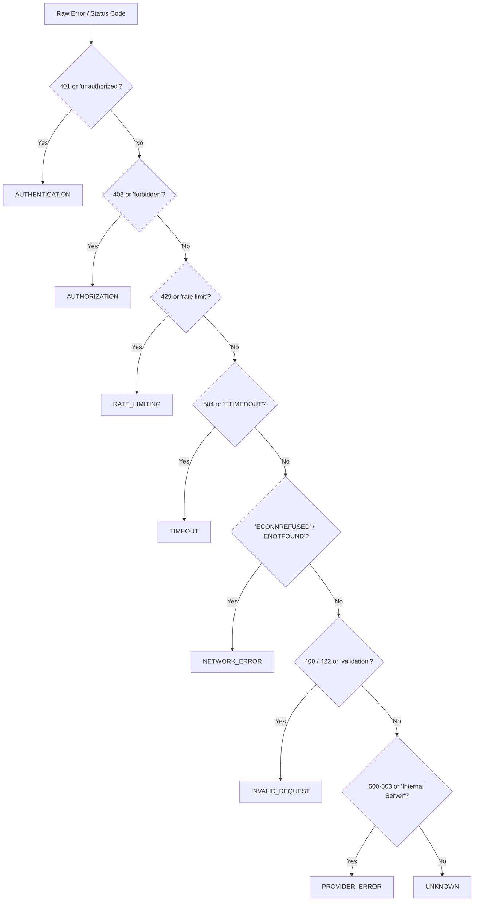

# FlowPilot Integration Health Analytics

## 1. Executive Architectural Overview

FlowPilot's **Integration Health Analytics Engine** (`src/core/analytics/integrationHealthService.ts`) provides telemetry, performance tracking, and failure diagnostics across all third-party integrations and inbound webhook receivers.

Unlike simple configuration checkers, FlowPilot observes actual operational invocations by aggregating:
1. **Inbound Webhook Deliveries**: HTTP ingest events captured in the local webhook delivery log.
2. **Outbound Integration Execution Steps**: Traces emitted by action nodes (`integration.slack.*`, `integration.telegram.*`, `integration.smtp.*`, `integration.googleSheets.*`, and generic `http.*`) during workflow executions.
3. **Encrypted Credential Metadata**: Formally validated vault records in `credentialStore`.

---

## 2. Telemetry Coverage & Operational Data Sources

| Integration Domain | Telemetry Source | Latency Tracking | Status Codes / Errors | Retention / Storage Buffer |
| :--- | :--- | :--- | :--- | :--- |
| **Inbound Webhooks** | `webhookStore` deliveries | Request-to-response duration ($ms$) | 200, 400, 401, 403, 504, 500 | Rolling circular buffer of **500 most recent records** (`.data/webhooks.json`) |
| **Slack Notifications** | `executionStore` step traces | Outbound HTTP dispatch duration ($ms$) | JSON response codes, Slack error codes | Retained per workflow execution run in `.data/executions.json` |
| **Telegram Alerts** | `executionStore` step traces | Bot API call round-trip ($ms$) | HTTP 429, 401, Telegram error strings | Retained per workflow execution run in `.data/executions.json` |
| **SMTP Relay Email** | `executionStore` step traces | SMTP handshake + dispatch ($ms$) | Connection refusal, auth rejection | Retained per workflow execution run in `.data/executions.json` |
| **Google Sheets Sync**| `executionStore` step traces | OAuth2 REST API round-trip ($ms$) | 401 expired token, 403 scope, 429 quota | Retained per workflow execution run in `.data/executions.json` |

---

## 3. Normalized Failure Categorization Engine

Every failed integration attempt is processed by `IntegrationHealthService.classifyFailure()` to map disparate HTTP codes and provider error strings into a standard diagnostic taxonomy:

### Taxonomy Definitions:
* **`AUTHENTICATION`**: Missing, invalid, expired, or malformed credentials or HMAC signature mismatches.
* **`AUTHORIZATION`**: Valid credentials, but lacking permissions or scopes for the target resource.
* **`RATE_LIMITING`**: Exceeded provider request quotas or concurrency limits (HTTP 429).
* **`TIMEOUT`**: Downstream host failed to respond within configured execution deadline (HTTP 504 / ETIMEDOUT).
* **`NETWORK_ERROR`**: Socket-level connection refusal, DNS resolution failure (`ENOTFOUND`), or broken pipes.
* **`INVALID_REQUEST`**: Client-side validation failure, schema violation, or unparseable JSON payload.
* **`PROVIDER_ERROR`**: Downstream service internal outage or maintenance window (HTTP 500, 502, 503).
* **`UNKNOWN`**: Unclassified or uncategorized runtime anomalies.

---

## 4. Architectural Boundaries & Reliability Distinctions

> [!IMPORTANT]
> **Credential Format Validity vs. External Service Health**
> A credential entry marked as `valid` in FlowPilot's vault verifies solely that the credential adheres to required syntax (e.g. non-empty bot token, valid AES-256-GCM ciphertext). It **does not guarantee** third-party service availability, live upstream token revocation status, or network connectivity. Operational health is derived strictly from real execution telemetry.

> [!NOTE]
> **Webhook Buffer Storage Limit Notice**
> Webhook delivery events are retained in an ephemeral rolling buffer capped at **500 records** in local JSON storage (`.data/webhooks.json`). Older deliveries are rotated out automatically using FIFO eviction.

---

## 5. Security & Sensitive Secret Redaction

To prevent sensitive API keys and tokens from appearing in telemetry feeds, diagnostics panels, or error logs, `IntegrationHealthService.sanitizeError()` enforces automatic masking:
* **Bearer Tokens**: Matches `Bearer [token]` and masks payload to `Bearer [REDACTED]`.
* **API Key Signatures**: Masks string prefixes `fpsec_`, `whsec_`, `sk_live_`, `sk_test_`, `xoxb-` to `[REDACTED_SECRET]`.
* **Length Truncation**: Caps error strings at 200 characters to prevent log injection or denial-of-service via huge payloads.

---

## 6. REST API Endpoints

All integration analytics endpoints enforce workspace scoping via `AuthContextManager.resolve(req)` and role-based access checks (`workflow:read`). Cross-workspace access attempts return HTTP 404.

* **`GET /api/v1/analytics/integrations/overview`**: Holistic workspace metrics, success rate, mean/median duration, status code breakdown, failure categories, and retention notices.
* **`GET /api/v1/analytics/integrations/[id]`**: Detail metrics for a specific integration service, accompanied by recent operations.
* **`GET /api/v1/analytics/integrations/webhooks`**: Inbound webhook delivery analytics, accepted/rejected/failed counts, status codes, and 500-buffer metadata.

