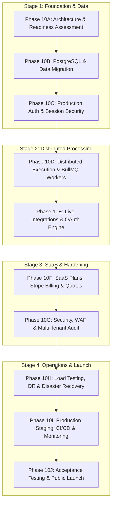

# FlowPilot Phase 10A: Production Architecture & Infrastructure Assessment

**Document Version:** 1.0.0  
**Milestone:** Phase 10A — Production Architecture & Infrastructure Assessment  
**Repository:** `flowpilot`  
**Active Branch:** `v1-development` (Commit: `6bfd4d3`)  
**Target Deployment:** Public Multi-Tenant SaaS  
**Assessment Date:** November 14, 2026  
**Status:** **Complete — Awaiting Explicit Approval for Phase 10B**  
**Execution Boundary:** **Assessment Only — No Production Code or Infrastructure Alterations**  

---

## 1. Executive Summary

FlowPilot has successfully completed Phases 1 through 9, creating a functional, visual no-code AI workflow automation platform equipped with graph editing, DAG workflow execution, webhook ingress, cron scheduling, team collaboration, multi-tenant workspace partitioning, and a full operational intelligence suite (Phases 9A–9H, 240/240 tests passing across 16 test suites, 107 production routes).

However, an exhaustive engineering audit of the codebase reveals that **FlowPilot currently operates as a single-process prototype with file-backed storage and mock integrations**. It cannot yet be deployed safely as a commercial, public-facing multi-tenant SaaS application.

### Critical Production Blockers Identified

1. **Storage & Data Integrity:**
   - 19 out of 20 entity stores persist to flat `.data/*.json` files on the local filesystem using synchronous `fs.writeFileSync`.
   - `workflowStore.ts` operates entirely in memory with optional browser `localStorage` fallback. Server-side workflow updates vanish upon process restart.
   - There are zero ACID transaction guarantees, no foreign-key cascades, no database connection pooling, and extreme vulnerability to race conditions and file corruption under concurrent writes.
2. **Execution & Queue Architecture:**
   - Background execution (`src/core/execution/queue.ts`) relies on an in-memory array (`queue: string[]`) and in-memory set (`running: Set<string>`).
   - Workflows queued in memory are destroyed if the server restarts or crashes.
   - In serverless hosting (e.g., Vercel), background promises freeze or terminate when the HTTP response completes.
   - `SchedulerEngine` runs on a single-node `setInterval` timer; running multiple application containers causes catastrophic duplicate execution of cron schedules.
3. **Authentication & Tenant Isolation:**
   - Authentication (`src/core/auth/authContext.ts`) is currently simulated via client-supplied request headers (`x-user-id`, `x-workspace-id`) with fallback to `usr_owner` and `ws_default`.
   - Any external user can spoof headers to gain instant full access to any customer workspace.
   - User records (`src/lib/storage/userStore.ts`) store plaintext metadata with no passwords, password hashes, salts, session tokens, or email verification flags.
   - There are no public user registration, login, logout, password recovery, or MFA flows.
4. **External Integrations:**
   - While the credential vault encrypts secrets with AES-256-GCM and SSRF protection is implemented, action execution in Google Sheets and Slack adapters returns simulated mock data rather than calling live provider REST APIs.
   - OAuth flows are missing state validation, PKCE exchange, automatic token refresh, and provider revocation handlers.
5. **Billing & Entitlements:**
   - Workspace limits and usage tracking exist (`workspaceLimitsStore`), but there is no integration with payment gateways (Stripe, LemonSqueezy, Paddle).
   - Subscription lifecycle webhooks, customer billing portals, failed payment grace periods, and commercial plan definitions are entirely absent.

**Conclusion:** FlowPilot requires a controlled, phase-by-phase hardening transformation across PostgreSQL migration, distributed queue infrastructure (Redis + BullMQ), cryptographically secure session authentication, real provider OAuth, and SaaS billing integration before opening to public customers.

---

## 2. Current Architecture & Technology Stack Audit

### 2.1 Technology Stack Inventory

| Component | Current Implementation | Production SaaS Assessment |
| :--- | :--- | :--- |
| **Framework** | Next.js 15.1.7 (App Router) | ✅ Modern, highly performant, supports React Server Components and standalone Node.js output. |
| **UI Library** | React 19.0.0, Lucide React 0.475.0, Tailwind CSS 3.4.17 | ✅ Solid, modern UI foundation with responsive dashboards. |
| **Workflow Canvas** | `@xyflow/react` 12.4.2 | ✅ Production-grade graph visualization and node editing. |
| **Runtime / Language** | Node.js (v20+ target), TypeScript 5.7.3 | ✅ Full strict TypeScript verification, 0 compilation errors. |
| **Validation** | Zod 3.24.2 | ✅ Standard schema validation for incoming payloads and inputs. |
| **Testing** | Vitest 3.0.5 (16 test suites, 240 tests) | ✅ Fast, deterministic unit and integration test runner. |
| **ORM / Database** | **None** (`.data/*.json` flat files + in-memory Maps) | ❌ **CRITICAL DEFECT:** Incompatible with multi-tenant concurrent SaaS. |
| **Job Queue** | **None** (In-memory FIFO array in `queue.ts`) | ❌ **CRITICAL DEFECT:** Volatile, lost on restart, cannot scale horizontally. |
| **Cache / Distributed Lock**| **None** (In-memory Sets and Maps) | ❌ **CRITICAL DEFECT:** Duplicate scheduler triggers across instances. |
| **Authentication** | Header inspection (`x-user-id`, `x-workspace-id`) | ❌ **CRITICAL DEFECT:** Header spoofing, zero session security or passwords. |
| **Payment Gateway** | **None** (Static `workspaceLimitsStore`) | ❌ **CRITICAL DEFECT:** No commercial billing or paid subscription capability. |

---

## 3. Storage & Data Persistence Audit

FlowPilot contains **20 store modules** in `src/lib/storage/`. An exhaustive audit of their persistence mechanisms yields:

| Store Module | Storage Mechanism | Target Data File / Medium | Concurrency & Integrity Assessment |
| :--- | :---: | :--- | :--- |
| `workflowStore.ts` | **Memory + Client `localStorage`** | None (Lost on server restart) | ❌ **Severe.** Server-side workflow updates are lost on reboot. |
| `executionStore.ts` | Map + Synchronous `fs` | `.data/executions.json` | ❌ **Severe.** File rewrite on every trace update; high risk of lockup/corruption. |
| `scheduleStore.ts` | Map + Synchronous `fs` | `.data/schedules.json` | ❌ High risk of race conditions during concurrent schedule updates. |
| `credentialStore.ts` | Map + Synchronous `fs` | `.data/credentials.json` | ⚠️ AES-256-GCM encrypted, but stored in flat JSON; single point of failure. |
| `webhookStore.ts` | Map + Synchronous `fs` | `.data/webhooks.json`, `webhook_deliveries.json` | ❌ Unbounded delivery logs degrade I/O and risk JSON parse crashes. |
| `userStore.ts` | Map + Synchronous `fs` | `.data/users.json` | ❌ No password hashes, salts, or verification tokens; flat JSON. |
| `workspaceStore.ts` | Map + Synchronous `fs` | `.data/workspaces.json` | ❌ Missing foreign-key relationships to memberships or billing records. |
| `membershipStore.ts` | Map + Synchronous `fs` | `.data/memberships.json` | ❌ Missing unique composite index `(workspaceId, userId)`. |
| `invitationStore.ts` | Map + Synchronous `fs` | `.data/invitations.json` | ⚠️ Plain tokens; vulnerable to brute-force enumeration without database hashing. |
| `aiUsageStore.ts` | Array + Synchronous `fs` | `.data/ai_usage.json` | ❌ Appended to single JSON file; unbounded growth will exhaust memory. |
| `aiConversationStore.ts`| Map + Synchronous `fs` | `.data/ai_conversations.json` | ❌ Entire conversation trees held in memory and written on every chat turn. |
| `alertRuleStore.ts` | Map + Synchronous `fs` | `.data/alert_rules.json` | ⚠️ In-memory lookup, manual serialization. |
| `alertIncidentStore.ts` | Map + Synchronous `fs` | `.data/alert_incidents.json` | ⚠️ Deduplication state held in single-instance memory. |
| `notificationStore.ts` | Map + Synchronous `fs` | `.data/notifications.json` | ⚠️ Unbounded notification array. |
| `workspaceLimitsStore.ts`| Map + Synchronous `fs` | `.data/workspace_limits.json` | ⚠️ Quota counters vulnerable to dirty reads under parallel executions. |
| `recommendationStore.ts` | Map + Synchronous `fs` | `.data/recommendations.json` | ⚠️ Diagnostic rules rewrite file on evaluation cycles. |
| `recommendationFeedbackStore.ts` | Map + Synchronous `fs` | `.data/recommendation_feedback.json`| ⚠️ Diagnostic user feedback. |
| `auditLogStore.ts` | Array + Synchronous `fs` | `.data/audit_logs.json` | ❌ Audit trail can be truncated or deleted with simple file manipulation. |
| `versionStore.ts` | Map + Synchronous `fs` | `.data/workflow_versions.json`| ❌ Large graph snapshots in single file will exceed Node.js buffer limits. |
| `workerStore.ts` | Map + Synchronous `fs` | `.data/workers.json` | ❌ Heartbeats write to file every 15 seconds; excessive disk churn. |

### Risks of File-Backed Storage in Public Production:
1. **Process Crash Data Loss:** Unflushed file buffers or crashed write operations produce truncated, corrupt JSON files (`SyntaxError: Unexpected end of JSON input`), rendering the server unbootable.
2. **Concurrency Collisions:** Multiple requests executing concurrently perform read-modify-write loops on in-memory Maps, causing lost updates.
3. **No Horizontal Scaling:** Multiple app instances running behind a load balancer cannot share local disk files, resulting in state divergence.
4. **Memory Exhaustion:** As executions and logs grow to tens of thousands of records, loading the entire JSON file into V8 memory will trigger Out-Of-Memory (OOM) fatal crashes.

---

## 4. Execution Engine & Queue Infrastructure Audit

### Current Execution Mechanics (`src/core/execution/`):
- `ExecutionQueue` maintains a memory array `queue: string[]` and `running: Set<string>`.
- Concurrency limit is default `maxConcurrency = 5`.
- Workflow execution runs asynchronously in the same Node.js event loop via `executionWorker.executeWorkflow()`.
- State transitions are recorded into `executionStore` at `QUEUED`, `VALIDATING`, `RUNNING`, `COMPLETED`, or `FAILED`.
- Abort handling uses `AbortController` stored in an in-memory Map.

### Production Vulnerabilities:
1. **Serverless Incompatibility:** On platforms like Vercel, serverless function runtimes freeze or terminate immediately after the HTTP response is returned. In-memory asynchronous workflows are abruptly killed mid-execution.
2. **Node Process Crash Recovery:** If the container restarts (e.g. during deployment or OS patching), all `QUEUED` and `RUNNING` executions are orphaned with no recovery worker.
3. **Single-Node Scheduler:** `SchedulerEngine` polls due schedules every 10 seconds via `setInterval`. If 3 containers are deployed for high availability, all 3 run the scheduler loop and trigger the exact same cron job 3 times.
4. **Lack of Backpressure & Distributed Rate Limiting:** A burst of 1,000 webhook events will swamp memory, triggering runaway CPU spikes and dropping requests.

---

## 5. Authentication, Tenant Isolation & RBAC Audit

### Current Authentication Flow (`src/core/auth/`):
- `AuthContextManager.resolve(req)` reads `x-user-id` and `x-workspace-id` headers, query parameters, or client cookies.
- If headers are missing, it silently defaults to `userId = 'usr_owner'` and `workspaceId = 'ws_default'`.
- RBAC permissions (`OWNER`, `ADMIN`, `EDITOR`, `VIEWER`) are verified against `membershipStore`.

### Vulnerabilities for Public SaaS:
1. **Direct Header Impersonation (CWE-287 / CWE-306):** Any client can send `x-user-id: usr_admin` and `x-workspace-id: ws_victim` to bypass all security and act as an administrator in any workspace.
2. **No Password Hashing or Salt:** `userStore` has no password fields, argon2/bcrypt hashing, or password complexity validation.
3. **No Session Cryptography:** No signed JWTs, no secure session tables with expiration timestamps, no `HttpOnly; Secure; SameSite=Strict` cookie protection.
4. **Missing Customer Account Lifecycle:** No public sign-up route, email confirmation tokens, password reset flows, session revocation, or multi-factor authentication (MFA/TOTP).

---

## 6. Integrations & External Service Audit

### 6.1 Integration Adapters (`src/core/integrations/adapters/`)

| Adapter | Test Connection Mode | Action Execution Mode | Production Readiness |
| :--- | :--- | :--- | :--- |
| **HTTP Request** | Live HTTP probe with SSRF guard | Live `fetch` with SSRF protection, timeout, and redirect control | ✅ **Production Ready** |
| **SMTP** | Validates host/port/auth syntax | Simulated delivery via `nodemailer` dummy or mock | ⚠️ Requires real verified SMTP transport (SendGrid/Postmark/Resend) |
| **Slack** | Live `auth.test` if token provided; syntax fallback | Mock delivery generating random message ID | ❌ Must call live `chat.postMessage` API |
| **Telegram** | Live `getMe` if token provided; syntax fallback | Mock delivery generating random message ID | ❌ Must call live `sendMessage` API |
| **Google Sheets**| Live tokeninfo check if `ya29.` token; fallback | Returns static sample rows / mock response | ❌ Must call live Google Sheets REST API v4 |

### 6.2 OAuth Architecture Gaps:
- Current Google integration accepts raw API keys or pre-generated bearer tokens.
- There is no OAuth 2.0 PKCE dance (`/api/v1/oauth/[provider]/authorize` and `/callback`).
- No encrypted token refresh daemon to rotate expiring OAuth access tokens (`expires_in = 3600`).
- No secure webhook verification for inbound Slack/Telegram interactions.

---

## 7. AI Provider Architecture & Observability Audit

### Current Capabilities (`src/core/ai/`):
- Multi-provider registry supporting Google Gemini, OpenAI, Anthropic, and Mock.
- Real API calls implemented for Gemini (`generativelanguage.googleapis.com`) and OpenAI (`api.openai.com/v1/chat/completions`).
- Granular token counting and historical pricing model (`AIPricingManager`) covering input/output token cost estimation across models.
- Graceful fallbacks for unpriced or unknown models.

### Production Needs:
- Workspace-level BYOK (Bring Your Own Key) vs. Platform-metered AI tokens.
- Circuit breakers and rate-limit backoff handling for OpenAI `429 Too Many Requests` or Anthropic overload errors.
- Streaming responses for interactive AI workflow builder chat (`/api/v1/ai/conversations`).

---

## 8. SaaS Billing, Plans & Entitlements Audit

### Current State:
- `workspaceLimitsStore.ts` tracks internal usage counters (`activeWorkflows`, `monthlyExecutions`, `aiTokensUsed`, `teamMembers`).
- Limits are checked before workflow creation and execution.

### Missing SaaS Infrastructure:
- **No Commercial Plan Definitions:** Free, Pro, Team, Enterprise tier configurations.
- **No Payment Provider Integration:** Stripe Checkout, Customer Portal, or Webhook listener.
- **No Billing State Machine:** Handling `active`, `past_due`, `canceled`, `trialing`, `unpaid`.
- **No Non-Destructive Grace Period:** When a customer's payment fails or execution quota is reached, workflows should pause gracefully with clear user notices rather than crashing.

---

## 9. Infrastructure, Hosting & Environment Requirements

### 9.1 Hosting Architecture Comparison

| Hosting Model | Pros | Cons | Recommendation |
| :--- | :--- | :--- | :--- |
| **Pure Serverless (Vercel)** | Zero infra maintenance, global CDN, instant deployments. | Severe execution time limits (10s–60s), cannot run background workers or cron loops without external services (Inngest/QStash/Upstash). | ⚠️ Good for Web/API frontend only; poor fit for long-running workflows. |
| **Single Virtual Machine (VPS / EC2 / Hetzner)** | Inexpensive, full control over Node.js, Redis, and Postgres. | Single point of failure, manual SSL/backups/scaling, high operational burden. | ❌ Unsuitable for high-availability production SaaS. |
| **Containerized PaaS / Hybrid (Render / Railway / AWS ECS)** | Dedicated web containers + dedicated background worker containers + managed PostgreSQL + managed Redis. | Moderate cost, requires Docker configuration. | **✅ RECOMMENDED TARGET ARCHITECTURE** |

### 9.2 Recommended Infrastructure Topology:
1. **Frontend / Web API Service:** Next.js application running in container or Node.js server (autoscale 2+ instances).
2. **Background Worker Service:** Node.js worker instance running BullMQ workers for workflow DAG execution, retries, and scheduled polling.
3. **Database:** Managed PostgreSQL (AWS RDS, Neon, Supabase, or Railway PG) with connection pooling (PgBouncer).
4. **Cache & Queue Broker:** Managed Redis (AWS ElastiCache, Upstash Redis, or Redis Cloud) for BullMQ queues, rate limiting, and distributed locking.
5. **Object Storage:** S3-compatible storage (Cloudflare R2 or AWS S3) for workflow export artifacts, large execution payloads, and audit archives.
6. **Edge & CDN:** Cloudflare or AWS CloudFront for SSL termination, DDoS mitigation, and WAF rules.

---

## 10. Phased Implementation Roadmap (Phases 10A–10J)

To ensure zero downtime, preserve the existing 240/240 tests, and eliminate risks, Phase 10 must proceed in strict sequential stages:

### Milestone Breakdown:
- **Phase 10A (Current):** Production Architecture, Infrastructure Assessment & Environment Specifications.
- **Phase 10B:** PostgreSQL database setup, Prisma ORM schema design, relational foreign keys, automated data migration from `.data/*.json`, backward compatibility layer.
- **Phase 10C:** Authentication system implementation: public registration, Argon2id password hashing, email verification, cryptographically signed HTTP-only session cookies, session store, CSRF, and user profile management.
- **Phase 10D:** Distributed queue architecture: Redis + BullMQ integration, dedicated worker process, distributed schedule locking (Redlock), graceful crash recovery, idempotency keys.
- **Phase 10E:** Real external integrations: live Google Sheets API v4, live Slack API, live Telegram API, OAuth 2.0 PKCE flow, automated token refresh.
- **Phase 10F:** SaaS billing and subscription engine: Stripe Checkout, customer billing portal, webhook listener with HMAC validation, non-destructive limit enforcement.
- **Phase 10G:** Security hardening: rate limiting (Upstash/Redis), input sanitization, security headers (CSP, HSTS), tenant isolation penetration testing, audit log durability.
- **Phase 10H:** Performance & disaster recovery: load testing (k6), database connection pool tuning, automated backup script, verified restore drill.
- **Phase 10I:** Deployment pipeline: GitHub Actions CI/CD, staging environment verification, SSL configuration, Sentry error monitoring, OpenTelemetry traces.
- **Phase 10J:** End-to-end user acceptance testing, public onboarding verification, launch checklist sign-off, production go-live.

---

## 11. Cost & Operational Budget Estimate (SaaS Launch Tier)

| Service | Recommended Provider | Tier / Configuration | Estimated Monthly Cost |
| :--- | :--- | :--- | :--- |
| **Web & Worker Compute** | Railway / Render / AWS ECS | 2 Web Instances + 1 Worker Instance (2GB RAM, 1 vCPU each) | $35 - $60 / month |
| **Managed PostgreSQL** | Neon / Supabase / AWS RDS | 2 vCPU, 4GB RAM, 20GB Storage + Automated Daily Backups | $25 - $50 / month |
| **Managed Redis** | Upstash / Redis Cloud | 1GB memory, multi-AZ high availability | $10 - $20 / month |
| **Transactional Email** | SendGrid / Resend / Postmark | 50,000 emails/month (Verification & Alerts) | $15 - $20 / month |
| **Domain & DNS / WAF** | Cloudflare | Free Tier / Pro ($20) with DDoS Protection | $0 - $20 / month |
| **Error Monitoring** | Sentry | Developer / Team Tier | $0 - $29 / month |
| **Total Estimated Run-Rate** | — | **High Availability Public SaaS Launch** | **~$85 - $199 / month** |

---

## 12. Recommendation & Verification Statement

1. **Do not start Phase 10B implementation** until this assessment and the companion architecture document (`docs/PHASE_10_PRODUCTION_ARCHITECTURE.md`) have been reviewed and approved by the project team.
2. **Preserve existing functionality:** Every step of Phase 10 must run the existing 240-test suite to ensure zero regressions in workflow logic, expression resolution, graph validation, analytics, and recommendation scoring.
3. **No mock production claims:** FlowPilot will not be certified "Production Ready" based merely on successful builds; readiness requires verified database durability, isolated customer authentication, distributed job completion, and verified billing webhooks.
