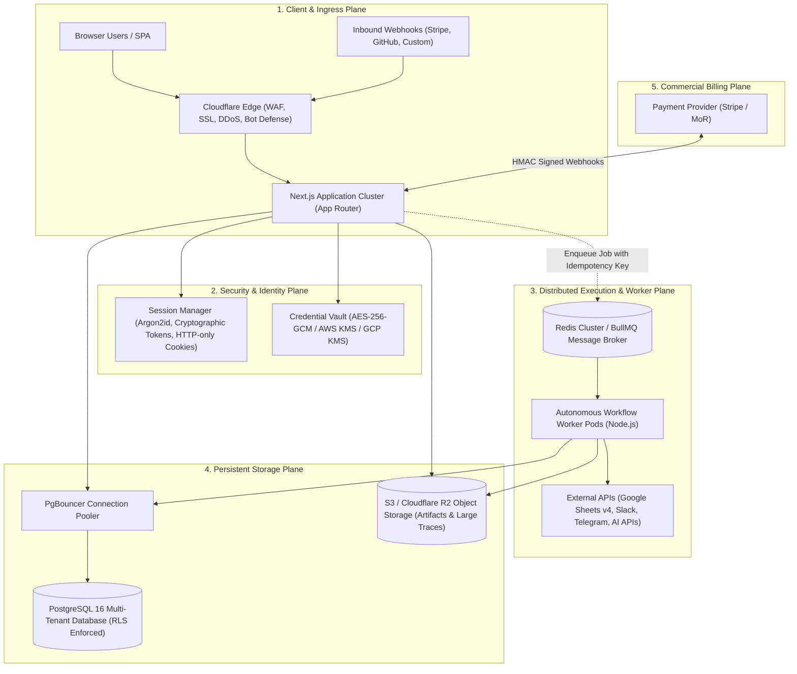
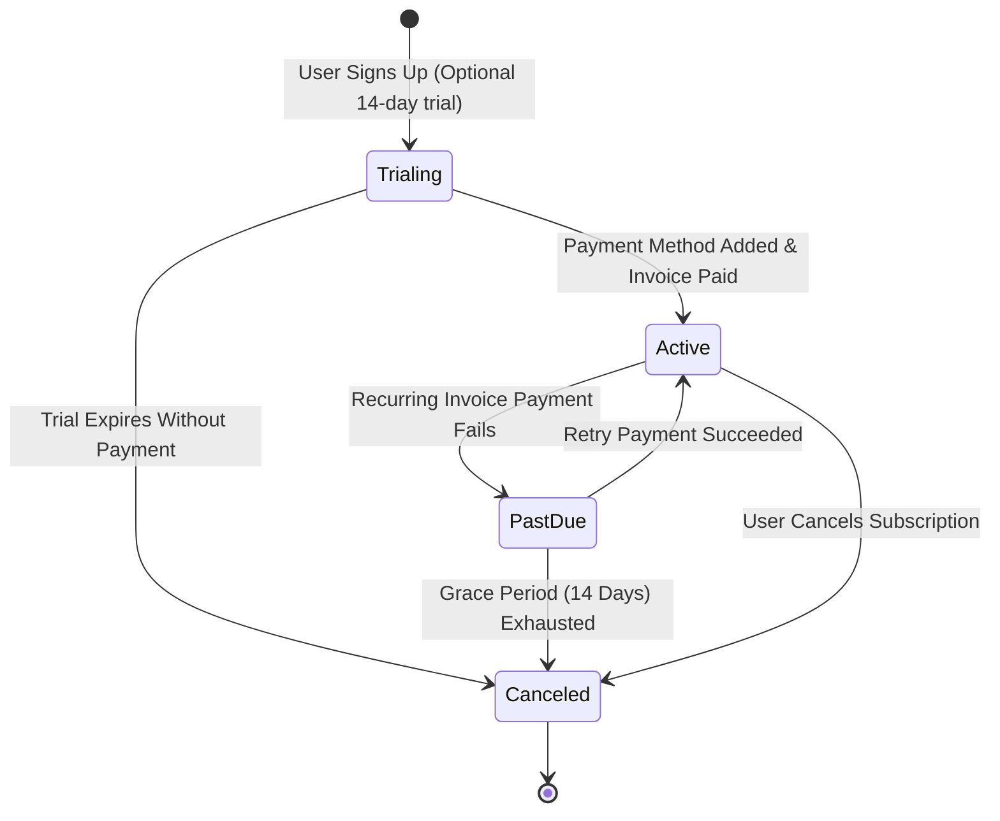

# FlowPilot Phase 10: Production SaaS Architecture Specification & Engineering Reference

**Project:** FlowPilot — Universal Visual No-Code AI Workflow Automation Platform  
**Document Version:** 2.0.0 (Comprehensive Architecture & ADR Release)  
**Milestone Target:** Phase 10 (Production Launch & Hardening)  
**Author:** Antigravity Engineering Architecture Team  
**Date:** November 14, 2026  
**Status:** **Proposal & Review — Awaiting Explicit Owner Authorization for Phase 10B**  
**Execution Boundary:** **Documentation & Verification Only — No Code or Infrastructure Alterations**  

---

## 1. Executive Architecture Summary

FlowPilot is transitioning from a single-process, local-storage prototype into a high-availability, multi-tenant public SaaS platform.

The target production architecture decouples user-facing interactive traffic (Next.js React Server Components & API routes) from long-running, asynchronous workflow DAG execution (Node.js background worker processes). All persistent operational data is centralized in an ACID-compliant relational database, job dispatching is coordinated via a persistent distributed queue with dead-letter handling, distributed cron schedules are synchronized with distributed locking, and identity is secured with cryptographic sessions and server-side tenant scoping.



---

## 2. Architecture Decision Records (ADRs)

To prevent premature technology lock-in and evaluate all technical, operational, and commercial trade-offs, the following Architecture Decision Records govern Phase 10.

---

### ADR-001: Primary Relational Database & ORM Strategy

* **Status:** Proposed
* **Context:** FlowPilot currently uses 19 flat `.data/*.json` files and 1 in-memory store (`workflowStore.ts`). These lack ACID transactions, foreign keys, concurrent write locks, and connection pooling.
* **Proposed Option:** **PostgreSQL 16** with **Prisma ORM**.
* **Alternative Options Evaluated:**
  1. *PostgreSQL 16 with Drizzle ORM:* Extremely lightweight, close to raw SQL, zero client overhead. However, Prisma provides superior declarative schema migrations (`prisma migrate`), automated relation validation, and mature ecosystem integrations matching our existing TypeScript interfaces.
  2. *PostgreSQL with Kysely / Raw `pg`:* Maximum query control and lowest latency, but requires writing manual migration scripts and verbose query builders, increasing delivery risk.
  3. *MongoDB / NoSQL:* Naturally stores JSON workflow graphs. However, multi-tenant RBAC, audit logging, billing subscriptions, and strict relational integrity across users, workspaces, and workflows require ACID foreign-key constraints and transactional isolation that document databases compromise.
* **Benefits of PostgreSQL + Prisma:**
  - Full ACID transaction compliance prevents corrupt execution traces and quota counters.
  - Native `JsonB` data type stores dynamic workflow graph topologies (`nodes`, `edges`), arbitrary trigger payloads, and node execution outputs with GIN indexing capability.
  - Declarative migrations with rollback tracking.
  - Strong typing generated directly into `@prisma/client`.
* **Limitations & Trade-offs:**
  - Prisma client query engine adds modest binary size and connection overhead; mitigated via PgBouncer connection pooling.
* **Security Implications:**
  - Supports PostgreSQL Row-Level Security (RLS) to enforce workspace boundary isolation at the database engine level.
* **Operational Implications:**
  - Managed PostgreSQL services (Neon, Supabase, AWS RDS) offer automated daily snapshots, point-in-time recovery (PITR), and high availability with zero server maintenance.
* **Recommendation:** Adopt **PostgreSQL 16 + Prisma ORM** as the default relational persistence engine for Phase 10B.

---

### ADR-002: Distributed Queue & Asynchronous Execution Engine

* **Status:** Proposed
* **Context:** `src/core/execution/queue.ts` runs an in-memory FIFO queue (`queue: string[]`) and `running: Set<string>`. If the Node.js process crashes, restarts during deployment, or is scaled horizontally across multiple instances, all queued and running workflows are abruptly dropped or duplicated.
* **Proposed Option:** **Redis 7.2 (Cluster / Sentinel)** with **BullMQ**.
* **Alternative Options Evaluated:**
  1. *PostgreSQL-backed Queue (`pg-boss` / Graphile Worker / SKIP LOCKED):* Avoids adding Redis as an infrastructure dependency. However, high-throughput workflow execution (hundreds of state updates, heartbeats, and ticks per second) generates severe write churn, table bloat, and aggressive VACUUM load on the primary transactional database.
  2. *AWS SQS / Google Cloud Tasks:* Fully managed serverless queues. However, local developer experience is poor (requires localstack or emulators), delay/priority semantics are rigid, and lack integrated worker heartbeat lock renewal available natively in BullMQ.
  3. *RabbitMQ / Kafka:* Enterprise message buses. Unnecessarily complex to operate and manage for DAG task orchestration at FlowPilot's initial and medium SaaS scale.
* **Benefits of Redis + BullMQ:**
  - High throughput in-memory queueing with sub-millisecond job claiming.
  - Redis persistence (AOF + RDB) ensures jobs survive broker restarts.
  - Native support for job timeouts, exponential backoff retries, dead-letter queues (DLQ), and delayed jobs.
  - Granular concurrency control per worker process.
  - Stalled job detection: if a worker pod crashes or runs out of memory (`OOMKilled`), BullMQ automatically detects the expired lock and transfers the job to another healthy worker.
* **Limitations & Trade-offs:**
  - Introduces Redis as a required infrastructure component.
* **Security Implications:**
  - Redis connection secured with TLS (`rediss://`) and strong AUTH password. No execution payloads containing decrypted master secrets are stored bare in Redis; only encrypted references or sanitized execution IDs are queued.
* **Recommendation:** Adopt **Redis + BullMQ** for distributed background execution in Phase 10D.

---

### ADR-003: Distributed Scheduler & Lock Coordination

* **Status:** Proposed
* **Context:** `src/core/scheduler/schedulerEngine.ts` uses a single-node `setInterval` polling loop with an in-memory lock (`inFlightSchedules = new Set<string>()`). In a production multi-container cluster, multiple workers evaluate cron schedules simultaneously, leading to catastrophic duplicate execution of scheduled workflows.
* **Proposed Option:** **BullMQ Repeatable Jobs** combined with **Redis Redlock / Distributed Locks**.
* **Alternative Options Evaluated:**
  1. *PostgreSQL Advisory Locks (`pg_try_advisory_lock`):* Uses the database to elect a single schedule evaluator. Good fallback, but creates connection contention during tight scheduler polling loops.
  2. *External Serverless Cron (AWS EventBridge / Cloudflare Cron Triggers / GitHub Actions):* Decouples the timer completely. Excellent for triggering an ingestion webhook, but requires external infrastructure provisioning for every user-created schedule.
* **Benefits of BullMQ Repeatable Jobs:**
  - Workflows configured with cron expressions (`cronParser.ts`) are registered as repeatable jobs in Redis.
  - BullMQ guarantees that only a single worker instance picks up and evaluates the scheduled job tick at any given minute.
  - Native timezone support.
* **Limitations & Trade-offs:**
  - Clock skew between worker nodes must be kept under 1 second via NTP synchronization.
* **Recommendation:** Transition from process `setInterval` to **BullMQ Repeatable Jobs** with **Redis distributed locks** in Phase 10D.

---

### ADR-004: Production Authentication & Session Security Strategy

* **Status:** Proposed
* **Context:** `AuthContextManager.resolve()` trusts incoming client headers (`x-user-id`, `x-workspace-id`) with fallback to default developer accounts. There is no user registration, password verification, or cryptographically signed session.
* **Proposed Option:** **Custom Database Session Engine** with **Argon2id** password hashing and **`__Host-` prefixed HTTP-only secure session cookies**.
* **Alternative Options Evaluated:**
  1. *NextAuth.js (Auth.js v5):* Popular in Next.js ecosystem. Good for social OAuth, but frequently suffers from breaking version migrations, complex edge middleware requirements, and awkward integration with custom multi-tenant workspace membership models.
  2. *Hosted Identity Provider (Clerk / Auth0 / Supabase Auth):* Offloads all auth infrastructure. However, per-user pricing escalates quickly ($20–$100+/mo for multi-tenant teams), vendor lock-in is high, and synchronizing user state with internal PostgreSQL memberships introduces webhook lag and data dual-ownership.
  3. *Stateless JWT in Cookies:* Low database overhead. However, instant session revocation (e.g. on password reset or compromised session) requires maintaining a revocation blocklist, defeating the stateless benefit.
* **Benefits of Database-Backed Session Engine:**
  - Full sovereignty over user data, credentials, and tenant memberships.
  - Instant session revocation from any device via single database query.
  - Zero third-party identity vendor costs.
  - Passwords hashed with `argon2id` (winner of the Password Hashing Competition; resistant to GPU/ASIC cracking).
  - Session cookies use `__Host-fp_session` with `Secure; HttpOnly; SameSite=Strict; Path=/`.
* **Limitations & Trade-offs:**
  - Requires writing and maintaining registration, login, email verification, and password reset route handlers.
* **Recommendation:** Implement **Database-Backed Sessions with Argon2id** in Phase 10C.

---

### ADR-005: SaaS Billing & Payment Provider Evaluation

* **Status:** Conditional Proposal — Business Evaluation Required
* **Context:** FlowPilot requires recurring subscription billing, customer invoicing, and usage entitlement enforcement for public SaaS operations.
* **Proposed Option:** **Stripe Billing** (Primary Evaluation Candidate) vs. **Merchant of Record (LemonSqueezy / Paddle)**.
* **Comparative Evaluation:**

| Dimension | Direct Gateway (Stripe Billing) | Merchant of Record (LemonSqueezy / Paddle) |
| :--- | :--- | :--- |
| **Legal Role** | FlowPilot is the Merchant of Record. | LemonSqueezy/Paddle is the Merchant of Record. |
| **Tax & VAT Compliance** | Handled via Stripe Tax (additional fee) or manual filing. | Handled 100% automatically by the provider globally. |
| **Transaction Fees** | ~2.9% + 30¢ + billing fees (~0.5% - 0.8%). | ~5% + 50¢ (inclusive of global tax handling). |
| **Global Payouts** | Requires business entity in supported Stripe countries (~46 countries). | Supports payouts to creators/founders in 100+ countries. |
| **Webhook Model** | Industry standard HMAC webhooks; highly reliable. | Webhooks supported; slightly less granular subscription events. |
| **Customer Portal** | Out-of-the-box self-serve billing portal. | Hosted customer billing portal included. |

* **Decision Prerequisite:** The business owner must determine business incorporation jurisdiction and tax compliance capacity before selecting between Stripe and a Merchant of Record.
* **Architecture Strategy:** The FlowPilot billing subsystem (`src/core/billing/`) must use an **Abstract Billing Adapter Interface** (`IBillingProvider`), decoupling checkout, subscription status syncing, and webhook processing from provider-specific SDKs. This allows switching between Stripe and LemonSqueezy without touching core entitlement logic.

---

## 3. Infrastructure, Hosting & Deployment Topology

### 3.1 Hosting Options Comparison

| Component | Option A (Recommended Managed PaaS) | Option B (Enterprise Cloud) | Option C (Serverless Frontend + VPS Worker) |
| :--- | :--- | :--- | :--- |
| **Web Service (Next.js)** | **Railway / Render Web Container** (2+ instances) | AWS ECS Fargate / GCP Cloud Run | Vercel (Frontend only) |
| **Worker Service** | **Railway / Render Background Worker** (Node.js) | AWS ECS Fargate Worker | Dedicated VPS (Hetzner / DigitalOcean) |
| **PostgreSQL** | **Neon / Supabase / Railway Postgres** (Managed) | AWS RDS PostgreSQL 16 (Multi-AZ) | Managed Cloud Database |
| **Redis** | **Upstash Redis / Redis Cloud** (Managed) | AWS ElastiCache for Redis | Managed Redis |
| **Object Storage** | **Cloudflare R2** (Zero egress fees, S3 compatible) | AWS S3 Standard | Cloudflare R2 |
| **Email Delivery** | **Resend / Postmark / SendGrid** | AWS SES | Resend / Postmark |
| **Observability** | **Sentry** (Errors) + OpenTelemetry | Datadog / AWS CloudWatch | Sentry + BetterStack |

### 3.2 Application & Worker Process Separation
To guarantee that intensive workflow execution (e.g. processing large JSON arrays, image transforms, or slow HTTP integrations) never starves the user-facing dashboard:
1. **Web Container Process:**
   - Runs `next start -p 3000`.
   - Handles HTTP requests, server actions, dashboard rendering, webhook ingress, and authentication.
   - Enqueues jobs to Redis; **never** executes workflow DAGs synchronously.
2. **Worker Container Process:**
   - Runs dedicated worker entry point `dist/worker.js` (or `tsx src/core/execution/workerRunner.ts`).
   - Connects to BullMQ queue as consumer.
   - Executes topological DAG node drivers, evaluates conditions, and writes execution steps to PostgreSQL.
   - Can be scaled independently from 1 worker pod to 20+ worker pods based on queue depth metrics.

---

## 4. Multi-Tenant Security & Tenant Isolation Architecture

### 4.1 Request Authorization & Context Injection
1. Incoming request reaches Next.js middleware.
2. Session cookie `__Host-fp_session` is decrypted and validated against the database session store.
3. User membership in the target `workspaceId` is verified.
4. If valid, an immutable request context is constructed:
   ```typescript
   interface RequestTenantContext {
     user: { id: string; email: string; name: string };
     workspace: { id: string; slug: string; isArchived: boolean };
     role: 'OWNER' | 'ADMIN' | 'EDITOR' | 'VIEWER';
   }
   ```
5. If invalid, the request is terminated with HTTP 401 Unauthorized or HTTP 403 Forbidden. Client header overrides (`x-user-id`, `x-workspace-id`) are ignored and stripped.

### 4.2 PostgreSQL Row-Level Security (RLS)
In addition to application-level query scoping (`where: { workspaceId }`), PostgreSQL engine-level RLS provides defense-in-depth:
```sql
-- Enable RLS on core multi-tenant tables
ALTER TABLE "Workflow" ENABLE ROW LEVEL SECURITY;
ALTER TABLE "Execution" ENABLE ROW LEVEL SECURITY;
ALTER TABLE "Credential" ENABLE ROW LEVEL SECURITY;

-- Enforce workspace isolation policy
CREATE POLICY workspace_isolation_policy ON "Workflow"
  FOR ALL
  USING (workspace_id = current_setting('app.current_workspace_id', true));
```

### 4.3 Credential Vault Architecture
- Credentials stored in `Credential` table are encrypted using **AES-256-GCM**.
- Key hierarchy:
  - **Master Key (`FLOWPILOT_ENCRYPTION_KEY`):** 32-byte cryptographically secure key stored in environment secrets manager (AWS Secrets Manager, Doppler, or Railway Secrets).
  - **Ciphertext Format:** Stored as `iv:authTag:ciphertext` in database.
  - Decryption occurs only in worker memory at the exact moment of execution; decrypted tokens are never returned in public API payloads or persisted in logs.

---

## 5. Storage Migration & Data Integrity Strategy

### 5.1 Mapping of 20 Existing Stores to Relational PostgreSQL Entities

| Existing Store (`src/lib/storage/`) | Current Storage | Target Relational Entity (Prisma) | Migration Type |
| :--- | :--- | :--- | :--- |
| `userStore.ts` | `.data/users.json` | `User` table | Relational ETL |
| `workspaceStore.ts` | `.data/workspaces.json` | `Workspace` table | Relational ETL |
| `membershipStore.ts` | `.data/memberships.json` | `Membership` table | Relational ETL + Composite Unique Key |
| `invitationStore.ts` | `.data/invitations.json` | `Invitation` table | Relational ETL |
| `workflowStore.ts` | Memory / localStorage | `Workflow` table | Relational ETL + JsonB Graph Topology |
| `versionStore.ts` | `.data/workflow_versions.json` | `WorkflowVersion` table | Relational ETL + JsonB Graph Topology |
| `executionStore.ts` | `.data/executions.json` | `Execution` & `ExecutionStep` tables | Normalized Master-Detail ETL |
| `scheduleStore.ts` | `.data/schedules.json` | `Schedule` table | Relational ETL |
| `credentialStore.ts` | `.data/credentials.json` | `Credential` table | Relational ETL (AES-256-GCM preserved) |
| `webhookStore.ts` | `.data/webhooks.json`, `deliveries` | `WebhookConfig` & `WebhookDelivery` | Normalized Relational ETL |
| `aiUsageStore.ts` | `.data/ai_usage.json` | `AIUsageRecord` table | Relational Time-Series ETL |
| `aiConversationStore.ts`| `.data/ai_conversations.json` | `AIConversation` & `AIMessage` | Normalized Relational ETL |
| `alertRuleStore.ts` | `.data/alert_rules.json` | `AlertRule` table | Relational ETL |
| `alertIncidentStore.ts` | `.data/alert_incidents.json`| `AlertIncident` table | Relational ETL |
| `notificationStore.ts` | `.data/notifications.json` | `Notification` table | Relational ETL |
| `workspaceLimitsStore.ts`| `.data/workspace_limits.json`| `WorkspaceLimits` table | Relational ETL (1-to-1 Workspace) |
| `recommendationStore.ts` | `.data/recommendations.json`| `Recommendation` table | Relational ETL + JsonB Evidence |
| `recommendationFeedbackStore.ts` | `.data/recommendation_feedback.json` | `RecommendationFeedback` table | Relational ETL |
| `auditLogStore.ts` | `.data/audit_logs.json` | `AuditLog` table | Relational Immutable Log ETL |
| `workerStore.ts` | `.data/workers.json` | Handled natively via Redis / BullMQ | Deprecated from persistent DB |

### 5.2 Phased Migration Protocol
1. **Pre-Migration Snapshot:** Full automated copy of `.data/` directory to `.data_backup_<timestamp>/`.
2. **Schema Provisioning:** Run `npx prisma migrate deploy` against target PostgreSQL instance.
3. **Automated Migration Script (`scripts/migrate-json-to-pg.ts`):**
   - Reads existing JSON records.
   - Validates schema conformity via Zod.
   - Executes transactional `upsert` queries to prevent duplicate migration.
   - Verifies record count parity (e.g. 4 users migrated, 2 workspaces migrated, N executions migrated).
4. **Dual-Read / Fallback Verification:** Automated verification script compares JSON store query results against PostgreSQL query results to prove 100% equivalence.
5. **Safe Cutover:** Switch application data layer flags to PostgreSQL; `.data/` directory retained as read-only historical archive.

---

## 6. Reliability, Crash Recovery & Disaster Recovery Runbook

### 6.1 Worker Failure & Crash Recovery
- **Crash Scenario:** Worker container is abruptly killed (e.g., node preemption, OOM, deployment SIGKILL).
- **Recovery Mechanism:**
  1. The BullMQ lock on active jobs expires (default: 30 seconds).
  2. The BullMQ supervisor detects the stalled job.
  3. The job is re-assigned to an active worker.
  4. The worker checks the execution's `ExecutionStep` traces in PostgreSQL: already completed steps are skipped, and the workflow resumes from the failed or interrupted node using idempotent state reconstruction.

### 6.2 Database Backups & Restore Verification
- **Automated Continuous WAL Archiving:** Managed PostgreSQL provider captures continuous Write-Ahead Logs.
- **Point-in-Time Recovery (PITR):** Enables rolling back database state to any specific second within the last 7 days.
- **Recovery Point Objective (RPO):** Maximum acceptable data loss < 5 minutes.
- **Recovery Time Objective (RTO):** Maximum acceptable service restoration time < 30 minutes.
- **Restore Verification Drill:** A scheduled automated CI task creates an ephemeral database from the latest snapshot, executes the 240-test suite against it, and tears it down, verifying backup recoverability.

---

## 7. Commercial Billing & Entitlements Engine

### 7.1 Commercial Subscription Lifecycle State Machine


### 7.2 Non-Destructive Entitlement Enforcement Rules
1. **Quota Overrun Behavior:** When a workspace reaches its monthly execution limit (e.g., 500/500 on Free tier):
   - Inbound webhook and manual execution requests return HTTP 429 (`QUOTA_EXCEEDED`) with a structured JSON error explaining the limit.
   - Scheduled workflows are paused with state `QUOTA_SUSPENDED`.
   - **No workflows, credentials, traces, or user data are EVER deleted.**
2. **Payment Failure Grace Period:**
   - On `invoice.payment_failed`, the workspace enters `PAST_DUE` state.
   - An alert notification is delivered to the workspace Owner.
   - Workflows continue to execute during a configurable **7-to-14 day grace period**.
   - If payment is not reconciled by day 14, execution is paused until billing is restored.

---

## 8. Summary of Architectural Approvals Required for Phase 10B

To formally proceed to Phase 10B implementation, the project owner should review and approve:
1. **Database & ORM:** PostgreSQL 16 managed instance with Prisma ORM.
2. **Queue & Broker:** Redis 7.2 with BullMQ for background worker execution and schedule locking.
3. **Session Authentication:** Server-side sessions with Argon2id and HTTP-only cookies.
4. **Billing Provider Evaluation:** Stripe as default evaluation target, using an abstract adapter interface to allow Merchant of Record (LemonSqueezy/Paddle) configuration if required by business jurisdiction.
5. **Implementation Governance:** Phased delivery following the Phase 10 roadmap without skipping verification gates.
