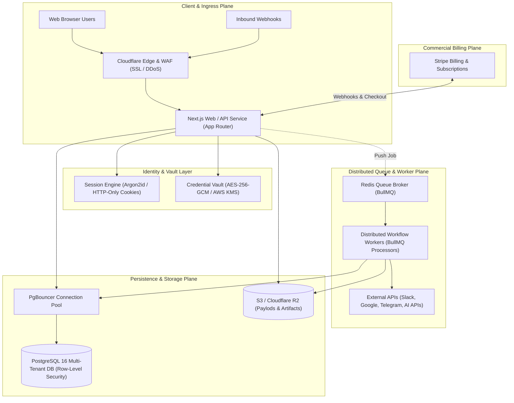
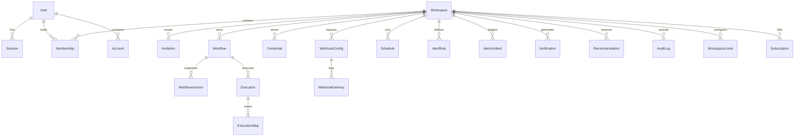
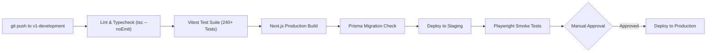

# FlowPilot Phase 10: Production SaaS Architecture Specification

**Project:** FlowPilot — Universal Visual No-Code AI Workflow Automation Platform  
**Document Version:** 1.0.0  
**Milestone Target:** Phase 10 (Production Launch & Hardening)  
**Author:** Antigravity Engineering Architecture Team  
**Date:** November 14, 2026  
**Status:** **Architecture Proposal — Awaiting Phase 10A Review & Approval**  

---

## 1. High-Level System Architecture

FlowPilot production architecture separates user-facing HTTP request routing from asynchronous workflow DAG execution. The architecture consists of four distinct operational planes:



---

## 2. Relational Database Architecture (PostgreSQL)

### 2.1 ORM Selection: Prisma ORM
**Choice:** Prisma ORM with `@prisma/client`.  
**Justification:**
1. Type-safety integrates directly with existing TypeScript models in `src/core/types/`.
2. Declarative schema migrations with `prisma migrate` ensure versioned, reproducible schema changes across environments.
3. Built-in connection pooling and robust PostgreSQL type support (including `JsonB` for workflow node graphs, configuration payloads, and execution traces).
4. Direct support for relational constraints, foreign keys, and indexes.

### 2.2 Relational Entity-Relationship Model



### 2.3 Proposed Prisma Schema (`prisma/schema.prisma`)

```prisma
datasource db {
  provider = "postgresql"
  url      = env("DATABASE_URL")
}

generator client {
  provider = "prisma-client-js"
}

// ----------------------------------------------------
// Authentication & Identity
// ----------------------------------------------------

enum Role {
  OWNER
  ADMIN
  EDITOR
  VIEWER
}

enum AccountStatus {
  ACTIVE
  SUSPENDED
  PENDING_VERIFICATION
}

model User {
  id              String        @id @default(cuid())
  email           String        @unique
  name            String
  passwordHash    String?       // Nullable for SSO/OAuth users
  avatarUrl       String?
  status          AccountStatus @default(PENDING_VERIFICATION)
  emailVerifiedAt DateTime?
  createdAt       DateTime      @default(now())
  updatedAt       DateTime      @updatedAt

  sessions        Session[]
  memberships     Membership[]
  accounts        Account[]
  invitationsSent Invitation[]  @relation("InvitedBy")
  auditLogs       AuditLog[]

  @@index([email])
}

model Session {
  id           String   @id @default(cuid())
  userId       String
  tokenHash    String   @unique
  userAgent    String?
  ipAddress    String?
  expiresAt    DateTime
  createdAt    DateTime @default(now())
  lastActiveAt DateTime @default(now())

  user         User     @relation(fields: [userId], references: [id], onDelete: Cascade)

  @@index([tokenHash])
  @@index([userId])
}

model Account {
  id                String  @id @default(cuid())
  userId            String
  provider          String  // "google", "github"
  providerAccountId String
  accessToken       String?
  refreshToken      String?
  expiresAt         Int?
  tokenType         String?
  scope             String?
  idToken           String?

  user              User    @relation(fields: [userId], references: [id], onDelete: Cascade)

  @@unique([provider, providerAccountId])
  @@index([userId])
}

// ----------------------------------------------------
// Multi-Tenant Workspaces & RBAC
// ----------------------------------------------------

model Workspace {
  id               String   @id @default(cuid())
  name             String
  slug             String   @unique
  ownerId          String
  isArchived       Boolean  @default(false)
  stripeCustomerId String?  @unique
  createdAt        DateTime @default(now())
  updatedAt        DateTime @updatedAt

  memberships      Membership[]
  invitations      Invitation[]
  workflows        Workflow[]
  credentials      Credential[]
  webhooks         WebhookConfig[]
  schedules        Schedule[]
  alertRules       AlertRule[]
  alertIncidents   AlertIncident[]
  notifications    Notification[]
  recommendations  Recommendation[]
  auditLogs        AuditLog[]
  limits           WorkspaceLimits?
  subscription     Subscription?
  aiUsageRecords   AIUsageRecord[]

  @@index([ownerId])
  @@index([slug])
}

model Membership {
  id           String    @id @default(cuid())
  workspaceId  String
  userId       String
  role         Role      @default(VIEWER)
  status       String    @default("active")
  createdAt    DateTime  @default(now())
  lastActiveAt DateTime?

  workspace    Workspace @relation(fields: [workspaceId], references: [id], onDelete: Cascade)
  user         User      @relation(fields: [userId], references: [id], onDelete: Cascade)

  @@unique([workspaceId, userId])
  @@index([workspaceId])
  @@index([userId])
}

model Invitation {
  id          String   @id @default(cuid())
  workspaceId String
  email       String
  role        Role     @default(VIEWER)
  token       String   @unique
  invitedById String
  expiresAt   DateTime
  status      String   @default("pending")
  createdAt   DateTime @default(now())

  workspace   Workspace @relation(fields: [workspaceId], references: [id], onDelete: Cascade)
  invitedBy   User      @relation("InvitedBy", fields: [invitedById], references: [id])

  @@index([token])
  @@index([workspaceId, email])
}

// ----------------------------------------------------
// Workflows & Versioning
// ----------------------------------------------------

enum WorkflowStatus {
  active
  draft
  paused
}

model Workflow {
  id             String         @id @default(cuid())
  workspaceId    String
  name           String
  description    String?
  status         WorkflowStatus @default(draft)
  version        Int            @default(1)
  nodes          Json           // JSONB representation of WorkflowNode[]
  edges          Json           // JSONB representation of WorkflowEdge[]
  viewport       Json?
  executionCount Int            @default(0)
  successCount   Int            @default(0)
  failureCount   Int            @default(0)
  lastExecutedAt DateTime?
  createdBy      String?
  lastModifiedBy String?
  createdAt      DateTime       @default(now())
  updatedAt      DateTime       @updatedAt

  workspace      Workspace      @relation(fields: [workspaceId], references: [id], onDelete: Cascade)
  versions       WorkflowVersion[]
  executions     Execution[]
  schedules      Schedule[]

  @@index([workspaceId])
  @@index([workspaceId, status])
}

model WorkflowVersion {
  id          String   @id @default(cuid())
  workflowId  String
  version     Int
  name        String
  description String?
  nodes       Json
  edges       Json
  createdBy   String?
  changeLog   String?
  createdAt   DateTime @default(now())

  workflow    Workflow @relation(fields: [workflowId], references: [id], onDelete: Cascade)

  @@unique([workflowId, version])
  @@index([workflowId])
}

// ----------------------------------------------------
// Execution & Telemetry
// ----------------------------------------------------

enum ExecutionStatus {
  QUEUED
  VALIDATING
  RUNNING
  COMPLETED
  FAILED
  CANCELLED
}

model Execution {
  id           String          @id @default(cuid())
  workspaceId  String
  workflowId   String
  workflowName String
  status       ExecutionStatus @default(QUEUED)
  triggerType  String
  triggerData  Json
  startedAt    DateTime        @default(now())
  completedAt  DateTime?
  durationMs   Int?
  retryCount   Int             @default(0)
  maxRetries   Int             @default(3)
  errorMessage String?
  stateHistory Json            // JSONB array of state transitions
  createdAt    DateTime        @default(now())
  updatedAt    DateTime        @updatedAt

  workflow     Workflow        @relation(fields: [workflowId], references: [id], onDelete: Cascade)
  steps        ExecutionStep[]

  @@index([workspaceId, startedAt(sort: Desc)])
  @@index([workflowId, startedAt(sort: Desc)])
  @@index([status])
}

model ExecutionStep {
  id          String    @id @default(cuid())
  executionId String
  nodeId      String
  nodeType    String
  nodeName    String
  status      String
  startedAt   DateTime
  completedAt DateTime?
  durationMs  Int?
  attempts    Int       @default(1)
  retryCount  Int       @default(0)
  input       Json?
  output      Json?
  error       String?

  execution   Execution @relation(fields: [executionId], references: [id], onDelete: Cascade)

  @@index([executionId])
  @@index([nodeId])
}

// ----------------------------------------------------
// Webhooks & Schedules
// ----------------------------------------------------

model WebhookConfig {
  id                 String   @id @default(cuid())
  workspaceId        String
  workflowId         String
  name               String
  token              String   @unique
  secretHash         String   // Hashed signing secret
  status             String   @default("active")
  allowedMethods     String[] @default(["POST"])
  authType           String   @default("hmac_sha256")
  rateLimitPerMin    Int      @default(60)
  replayToleranceSec Int      @default(300)
  deliveryCount      Int      @default(0)
  lastDeliveredAt    DateTime?
  createdAt          DateTime @default(now())
  updatedAt          DateTime @updatedAt

  workspace          Workspace @relation(fields: [workspaceId], references: [id], onDelete: Cascade)
  deliveries         WebhookDelivery[]

  @@index([token])
  @@index([workspaceId])
}

model WebhookDelivery {
  id             String        @id @default(cuid())
  webhookId      String
  workflowId     String
  executionId    String?
  status         String
  httpStatus     Int
  requestMethod  String
  headers        Json
  clientIp       String
  payloadPreview String
  durationMs     Int
  errorReason    String?
  createdAt      DateTime      @default(now())

  webhook        WebhookConfig @relation(fields: [webhookId], references: [id], onDelete: Cascade)

  @@index([webhookId, createdAt(sort: Desc)])
}

model Schedule {
  id           String    @id @default(cuid())
  workspaceId  String
  workflowId   String
  cron         String
  timezone     String    @default("UTC")
  enabled      Boolean   @default(true)
  lastRunAt    DateTime?
  nextRunAt    DateTime
  inputPayload Json?
  createdAt    DateTime  @default(now())
  updatedAt    DateTime  @updatedAt

  workspace    Workspace @relation(fields: [workspaceId], references: [id], onDelete: Cascade)
  workflow     Workflow  @relation(fields: [workflowId], references: [id], onDelete: Cascade)

  @@index([enabled, nextRunAt])
  @@index([workspaceId])
}

// ----------------------------------------------------
// Security & Credentials Vault
// ----------------------------------------------------

model Credential {
  id             String    @id @default(cuid())
  workspaceId    String
  name           String
  provider       String
  encryptedData  String    // AES-256-GCM ciphertext:iv:authTag
  status         String    @default("active")
  lastVerifiedAt DateTime?
  createdAt      DateTime  @default(now())
  updatedAt      DateTime  @updatedAt

  workspace      Workspace @relation(fields: [workspaceId], references: [id], onDelete: Cascade)

  @@index([workspaceId, provider])
}

// ----------------------------------------------------
// SaaS Billing, Usage & Entitlements
// ----------------------------------------------------

enum PlanTier {
  FREE
  PRO
  TEAM
  ENTERPRISE
}

enum SubscriptionStatus {
  TRIALING
  ACTIVE
  PAST_DUE
  CANCELED
  UNPAID
}

model Subscription {
  id                   String             @id @default(cuid())
  workspaceId          String             @unique
  stripeSubscriptionId String             @unique
  stripePriceId        String
  planTier             PlanTier           @default(FREE)
  status               SubscriptionStatus @default(ACTIVE)
  currentPeriodStart   DateTime
  currentPeriodEnd     DateTime
  cancelAtPeriodEnd    Boolean            @default(false)
  createdAt            DateTime           @default(now())
  updatedAt            DateTime           @updatedAt

  workspace            Workspace          @relation(fields: [workspaceId], references: [id], onDelete: Cascade)

  @@index([stripeSubscriptionId])
}

model WorkspaceLimits {
  id                   String    @id @default(cuid())
  workspaceId          String    @unique
  maxWorkflows         Int       @default(5)
  maxMonthlyExecutions Int       @default(1000)
  maxAiTokensPerMonth  Int       @default(50000)
  maxTeamMembers       Int       @default(2)
  maxActiveSchedules   Int       @default(3)
  usedWorkflows        Int       @default(0)
  usedExecutionsMonth  Int       @default(0)
  usedAiTokensMonth    Int       @default(0)
  usedTeamMembers      Int       @default(1)
  resetDate            DateTime
  updatedAt            DateTime  @updatedAt

  workspace            Workspace @relation(fields: [workspaceId], references: [id], onDelete: Cascade)
}

// ----------------------------------------------------
// Operational Intelligence, Alerts & Recommendations
// ----------------------------------------------------

model AlertRule {
  id          String   @id @default(cuid())
  workspaceId String
  name        String
  metric      String
  condition   String
  threshold   Float
  windowSec   Int
  cooldownMin Int
  channels    Json
  enabled     Boolean  @default(true)
  createdAt   DateTime @default(now())
  updatedAt   DateTime @updatedAt

  workspace   Workspace @relation(fields: [workspaceId], references: [id], onDelete: Cascade)
  incidents   AlertIncident[]

  @@index([workspaceId])
}

model AlertIncident {
  id             String    @id @default(cuid())
  workspaceId    String
  ruleId         String
  ruleName       String
  metric         String
  triggerValue   Float
  threshold      Float
  status         String    @default("OPEN")
  dedupKey       String
  occurrences    Int       @default(1)
  startedAt      DateTime  @default(now())
  acknowledgedAt DateTime?
  acknowledgedBy String?
  resolvedAt     DateTime?
  resolvedBy     String?

  workspace      Workspace @relation(fields: [workspaceId], references: [id], onDelete: Cascade)
  rule           AlertRule @relation(fields: [ruleId], references: [id], onDelete: Cascade)

  @@index([workspaceId, status])
  @@index([dedupKey])
}

model Notification {
  id          String   @id @default(cuid())
  workspaceId String
  incidentId  String?
  channel     String
  recipient   String
  status      String
  payload     Json
  createdAt   DateTime @default(now())

  workspace   Workspace @relation(fields: [workspaceId], references: [id], onDelete: Cascade)

  @@index([workspaceId, createdAt(sort: Desc)])
}

model Recommendation {
  id               String   @id @default(cuid())
  workspaceId      String
  workflowId       String
  category         String
  diagnosticRuleId String
  title            String
  impactDescription String
  remediation      String
  priorityScore    Int
  confidenceScore  Int
  evidence         Json
  status           String   @default("ACTIVE")
  snoozedUntil     DateTime?
  resolvedAt       DateTime?
  dismissedAt      DateTime?
  dedupKey         String   @unique
  createdAt        DateTime @default(now())
  updatedAt        DateTime @updatedAt

  workspace        Workspace @relation(fields: [workspaceId], references: [id], onDelete: Cascade)

  @@index([workspaceId, status])
  @@index([dedupKey])
}

model AIUsageRecord {
  id           String   @id @default(cuid())
  workspaceId  String
  workflowId   String?
  nodeId       String?
  provider     String
  model        String
  inputTokens  Int
  outputTokens Int
  costUsd      Float
  timestamp    DateTime @default(now())

  workspace    Workspace @relation(fields: [workspaceId], references: [id], onDelete: Cascade)

  @@index([workspaceId, timestamp(sort: Desc)])
}

model AuditLog {
  id          String   @id @default(cuid())
  workspaceId String
  userId      String?
  action      String
  resourceType String
  resourceId  String?
  details     Json?
  ipAddress   String?
  userAgent   String?
  timestamp   DateTime @default(now())

  workspace   Workspace @relation(fields: [workspaceId], references: [id], onDelete: Cascade)
  user        User?     @relation(fields: [userId], references: [id])

  @@index([workspaceId, timestamp(sort: Desc)])
}
```

---

## 3. Distributed Queue & Worker Architecture (BullMQ + Redis)

### 3.1 Why BullMQ + Redis?
- **Persistence & Recovery:** Jobs reside in Redis; if a worker crashes or node reboots, the job lock expires and is automatically claimed by another healthy worker.
- **Horizontal Scaling:** Any number of background worker containers can connect to the shared Redis cluster.
- **Built-in Backpressure & Concurrency:** Fine-grained concurrency limits per worker, rate-limiting per workspace, and job prioritization.
- **Dead-Letter Queues (DLQ):** Failed executions move to a DLQ after exponential backoff retries with full trace snapshots.
- **Distributed Scheduling (BullMQ Repeatable Jobs / Redlock):** Replaces single-process `setInterval` with distributed cron scheduling guaranteed to execute exactly once across multiple nodes.

### 3.2 Queue Topology

```
[Inbound Trigger / API]
         │
         ▼
[Next.js API Handler] ──(Enqueues with Idempotency Key)──► [Redis: "flowpilot-executions" Queue]
                                                                     │
                                    ┌────────────────────────────────┼────────────────────────────────┐
                                    ▼                                ▼                                ▼
                            [Worker Pod 1]                    [Worker Pod 2]                   [Worker Pod 3]
                            (BullMQ Consumer)                 (BullMQ Consumer)                (BullMQ Consumer)
                                    │                                │                                │
                                    └────────────────────────────────┼────────────────────────────────┘
                                                                     ▼
                                                   [Execute DAG via Topological Sort]
                                                                     │
                                                                     ▼
                                                   [Persist Traces to PostgreSQL via Prisma]
```

### 3.3 Worker Crash Recovery & Idempotency
1. **Idempotency Keys:** Every execution enqueue creates a deterministic job ID:
   `jobId = exec_${workspaceId}_${workflowId}_${hash(triggerPayload + timestamp)}`.
2. **Lock Expiration (Stall Interval):** BullMQ workers renew a heartbeat lock every 30s. If a worker process is killed (`SIGKILL` or OOM), BullMQ marks the job stalled and re-queues it according to retry policy.
3. **Execution State Machine:**
   `QUEUED` → `VALIDATING` → `RUNNING` → `COMPLETED` / `FAILED` / `CANCELLED`.
   Database updates are executed transactionally.

---

## 4. Authentication, Session Security & Tenant Isolation

### 4.1 Production Authentication Protocol
1. **Password Hashing:** `argon2id` (memory cost 64MB, time cost 3, parallelism 1) with per-user cryptographic salts.
2. **Session Model:** Server-side sessions stored in PostgreSQL `Session` table.
3. **Session Cookie:**
   - Name: `__Host-fp_session`
   - Attributes: `HttpOnly; Secure; SameSite=Strict; Path=/; Max-Age=604800` (7 days)
   - Value: Base64URL-encoded cryptographically secure 256-bit random token.
   - The token hash (`sha256(token)`) is verified against the database.
4. **Header Deprecation:** Header-based `x-user-id` and `x-workspace-id` resolution is **strictly rejected** in production requests; workspace context is resolved solely from authenticated user sessions and valid workspace memberships.
5. **CSRF Protection:** Double-submit cookie pattern with cryptographic origin and referer header verification on state-changing requests (`POST`, `PUT`, `PATCH`, `DELETE`).

### 4.2 Multi-Tenant Workspace Isolation
- **Tenant Context Guard:** An API middleware injects verified `workspaceId` and `userRole` into request context.
- **Database Scoping:** Every query executed through Prisma must include `where: { workspaceId }`.
- **PostgreSQL Row-Level Security (RLS):**
  PostgreSQL connection session configures:
  `SET LOCAL app.current_workspace_id = 'ws_...'`
  RLS policies enforce:
  `CREATE POLICY workspace_isolation ON "Workflow" USING (workspace_id = current_setting('app.current_workspace_id'));`

---

## 5. Live Integrations & OAuth 2.0 Engine

### 5.1 OAuth 2.0 Architecture
1. **Initiation (`/api/v1/oauth/[provider]/authorize`):**
   - Generates cryptographically secure random `state` and PKCE `code_verifier` / `code_challenge`.
   - Stores `state` and `code_verifier` in Redis with a 10-minute TTL.
   - Redirects to provider authorization consent screen (Google, Slack).
2. **Callback (`/api/v1/oauth/[provider]/callback`):**
   - Verifies `state` matches stored Redis state (mitigating CSRF).
   - Exchanges authorization code for `access_token` and `refresh_token`.
   - Encrypts tokens via AES-256-GCM before persisting to `Credential` table.
3. **Token Refresh Daemon:**
   - Background worker checks credentials whose `expiresAt < now() + 5 minutes`.
   - Performs refresh token grant with provider and updates encrypted vault record.

### 5.2 Real Provider Drivers

| Integration | Protocol | Real Action Driver Implementation |
| :--- | :--- | :--- |
| **Google Sheets** | REST API v4 | `https://sheets.googleapis.com/v4/spreadsheets/{id}/values/...` with OAuth Bearer token. |
| **Slack** | Web API | `https://slack.com/api/chat.postMessage` with Bot token (`xoxb-`). |
| **Telegram** | Bot API | `https://api.telegram.org/bot{token}/sendMessage`. |
| **SMTP** | SMTP / TLS | `nodemailer` transport connected to real SendGrid / Resend / AWS SES credentials. |

---

## 6. SaaS Subscription, Entitlements & Metering Engine

### 6.1 Commercial Tier Specification

| Feature / Limit | Free Tier | Pro Tier | Team Tier | Enterprise Tier |
| :--- | :---: | :---: | :---: | :---: |
| **Active Workflows** | 3 | 25 | 100 | Unlimited |
| **Monthly Executions** | 500 | 10,000 | 50,000 | Custom / Unlimited |
| **Active Schedules** | 1 | 10 | 50 | Unlimited |
| **AI Tokens / Month** | 25,000 | 250,000 | 1,000,000 | Custom / BYOK |
| **Team Members** | 1 (Owner only) | 3 | 10 | Unlimited |
| **Execution History Retention**| 7 days | 30 days | 90 days | 1 Year |
| **Target Pricing** | $0 / mo | $29 / mo | $99 / mo | Custom Contract |

*(Note: Pricing numbers are configurable parameters; final price points are subject to commercial business review).*

### 6.2 Stripe Integration Flow
1. **Checkout Session:** `/api/v1/billing/checkout` creates Stripe Checkout session with `client_reference_id = workspaceId`.
2. **Webhook Ingress (`/api/v1/billing/webhooks`):**
   - Validates Stripe HMAC signature using `stripe.webhooks.constructEvent()`.
   - Handles:
     - `checkout.session.completed` → Provisions subscription and updates `workspaceLimits`.
     - `invoice.paid` → Resets monthly execution counters and extends validity.
     - `invoice.payment_failed` → Marks subscription `PAST_DUE`, triggers notification.
     - `customer.subscription.deleted` → Gracefully downgrades workspace to Free tier.
3. **Non-Destructive Enforcement:**
   - If execution quota is reached, new manual/webhook triggers return HTTP 429 (`QUOTA_EXCEEDED`).
   - **Workflows, credentials, and data are NEVER deleted.**
   - Clear banner alert displayed in dashboard guiding customer to upgrade plan.

---

## 7. Infrastructure, CI/CD & Production Operations

### 7.1 Multi-Container Docker Deployment

- **Web Container:** Runs Next.js standalone server (`next start -p 3000`).
- **Worker Container:** Runs BullMQ processor daemon (`node dist/worker.js`).
- **Redis Container:** Redis 7.2 Alpine with AOF persistence.
- **Postgres Container / Managed DB:** PostgreSQL 16.

### 7.2 CI/CD Pipeline (GitHub Actions)


### 7.3 Disaster Recovery & Backup Runbook
- **Point-in-Time Recovery (PITR):** Automated continuous WAL archiving in PostgreSQL with 7-day retention.
- **Recovery Point Objective (RPO):** < 5 minutes of data loss.
- **Recovery Time Objective (RTO):** < 30 minutes to restore service in a clean region.
- **Backup Verification Drill:** Automated weekly restore into an isolated staging database to prove dump recoverability.

---

## 8. Summary of Architectural Approvals Required

Before proceeding to Phase 10B implementation, the user must review and approve:
1. **Database:** PostgreSQL with Prisma ORM.
2. **Queue:** Redis with BullMQ.
3. **Authentication:** Server-side sessions with Argon2id and HTTP-only cookies.
4. **Billing Provider:** Stripe (or explicit alternative such as LemonSqueezy/Paddle).
5. **Implementation Order:** 10B (DB) → 10C (Auth) → 10D (Queue) → 10E (Integrations) → 10F (Billing) → 10G (Security) → 10H (Scaling/DR) → 10I (Ops) → 10J (Launch).
