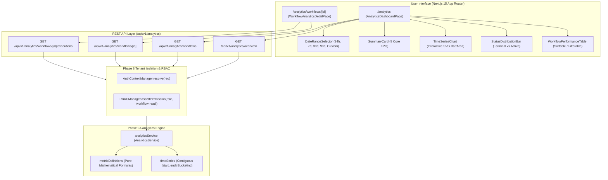

# FlowPilot: Phase 9B Implementation Report
**Milestone:** Phase 9B: Analytics Dashboard & Workflow Performance Detail  
**Repository:** `heyshahid/flowpilot`  
**Status:** COMPLETE & VERIFIED  

---

## 1. Executive Summary

Phase 9B builds the user-facing analytics and performance monitoring UI directly upon the Phase 9A Analytics Data Architecture. It introduces a comprehensive dashboard at `/analytics`, an individual workflow performance detail view at `/analytics/workflows/[id]`, dynamic date range filtering, responsive SVG-based time-series visualizations, execution status distribution, and paginated execution histories with sensitive payload redaction.

All metric calculations reuse the central Phase 9A `AnalyticsService` without any client-side formula duplication, artificial metric scaling, or fake numbers.

---

## 2. Architecture & Data Flow

---

## 3. Implemented Components & Routes

### 3.1. REST API Endpoints

| Endpoint | Method | Purpose | Security & Validation |
|:---|:---:|:---|:---|
| `/api/v1/analytics/overview` | `GET` | Returns execution summary KPIs and continuous time-series data bucketed by window. | Workspace-scoped, validates `timeWindow` and custom date ranges. |
| `/api/v1/analytics/workflows` | `GET` | Aggregated performance summaries across all workflows in the active workspace. | Strict tenant boundary, sorted by execution volume. |
| `/api/v1/analytics/workflows/[id]` | `GET` | Detailed performance report for a specific workflow (summary, daily duration trend, node metrics). | Returns 404 if workflow doesn't exist or belongs to another workspace (zero cross-tenant leakage). |
| `/api/v1/analytics/workflows/[id]/executions` | `GET` | Paginated execution history for a specific workflow. | Redacts raw payload parameters and secrets; supports `offset` and `limit` (max 100). |

### 3.2. Front-End Components

1. **`DateRangeSelector` (`src/components/analytics/DateRangeSelector.tsx`):**
   * Presets: Last 24 Hours, Last 7 Days, Last 30 Days, Last 90 Days, and Custom Range.
   * Custom range form with start and end date boundary validation.
   * Explicit reporting timezone display: `UTC`.
2. **`SummaryCard` (`src/components/analytics/SummaryCard.tsx`):**
   * Displays metric title, value, unit, sample size subtitle, and accent color.
   * Handles unavailable states with clean `N/A` styling and explanatory notes.
3. **`TimeSeriesChart` (`src/components/analytics/TimeSeriesChart.tsx`):**
   * Responsive SVG chart with stacked bars for completed (emerald) and failed (rose) runs.
   * Distinguishes genuine zero activity from missing data.
   * Interactive hover tooltip showing bucket label, total, completed, failed, and mean latency.
4. **`StatusDistributionBar` (`src/components/analytics/StatusDistributionBar.tsx`):**
   * Visual horizontal progress breakdown separating terminal statuses (completed vs failed) from in-flight (running, queued, waiting) and cancelled runs.
5. **`WorkflowPerformanceTable` (`src/components/analytics/WorkflowPerformanceTable.tsx`):**
   * Searchable and sortable table by runs, duration, or workflow name.
   * Displays runs, success rate badge, mean duration, last run date, and deep-link to workflow detail.
   * Accurate empty state: `"No executions recorded in this timeframe. Trigger a workflow to start collecting analytics."`

### 3.3. Main Dashboard & Workflow Detail Pages

* **`src/app/(dashboard)/analytics/page.tsx`:** Primary analytics dashboard integrating 8 KPI cards, time-series chart, status distribution, and workflow performance table with live refresh.
* **`src/app/(dashboard)/analytics/workflows/[id]/page.tsx`:** Workflow-specific detail page with breadcrumbs, builder link, workflow KPI summary, execution activity chart, and paginated execution history table.

---

## 4. Verification & Testing

### 4.1. Vitest Test Suite Results
All **145 / 145 tests passed (100%)** across all 10 test files:
* `tests/phase9b_analytics_dashboard.test.ts` (11 tests) — **Phase 9B Dashboard & APIs**
* `tests/phase9a_analytics.test.ts` (23 tests) — Phase 9A Analytics Engine
* `tests/phase8_team_collaboration.test.ts` (19 tests) — Team & RBAC
* `tests/phase7_ai.test.ts` (18 tests) — AI Assistant & Copilot
* `tests/phase6_advanced.test.ts` (21 tests) — Advanced Automation & Scheduling
* `tests/phase5_integrations.test.ts` (17 tests) — Core Integrations & Webhooks
* `tests/phase4_execution.test.ts` (15 tests) — Execution Engine
* `tests/phase3_builder.test.ts` (7 tests) — Visual Builder
* `tests/ui_store.test.ts` (8 tests) — UI Store
* `tests/engine.test.ts` (6 tests) — Core Engine

### 4.2. Next.js 15 Production Build
Production build compiled cleanly with **0 TypeScript or bundling errors** across all 64 static and dynamic routes.
