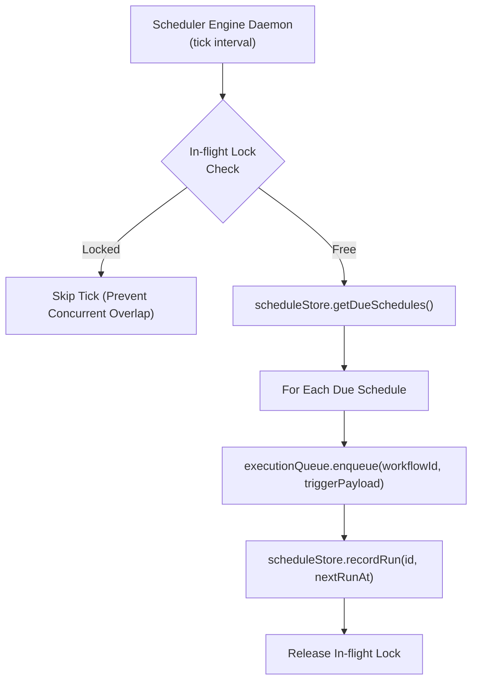

# FlowPilot Scheduling Engine Architecture

## 1. Overview

The FlowPilot Scheduling Engine provides high-precision, production-grade automated triggering for visual workflows. It supports:
- **Cron Expressions**: Standard 5-field syntax (`minute hour day-of-month month day-of-week`), range expressions (`1-5`), step increments (`*/15`), lists (`1,15,30`), and predefined human-readable presets (`@hourly`, `@daily`, `@weekly`, `@monthly`).
- **Interval Timing**: Execution every $N$ units of time (seconds, minutes, hours, days).
- **One-time Scheduled Executions**: Precise future timestamp triggering with automatic completion marking.

---

## 2. Architecture & Components



### Components:

1. **`CronParser` (`src/core/scheduler/cronParser.ts`)**:
   - Zero-dependency parser implementing POSIX cron standard.
   - Parses minute (`0-59`), hour (`0-23`), day of month (`1-31`), month (`1-12`), and day of week (`0-6` / `7` as Sunday).
   - Validates expressions via `isValid(expression)`.
   - Calculates next execution timestamp via `getNextRun(expression, fromDate, timezone)`.
   - Supports aliases:
     - `@hourly` -> `0 * * * *`
     - `@daily` -> `0 0 * * *`
     - `@weekly` -> `0 0 * * 0`
     - `@monthly` -> `0 0 1 * *`

2. **`ScheduleStore` (`src/lib/storage/scheduleStore.ts`)**:
   - File-backed persistent storage located at `.data/schedules.json`.
   - Pre-seeded with production schedules for CRM sync, lead digests, and inventory reconciliation.
   - Methods: `list()`, `getById()`, `save()`, `update()`, `delete()`, `getDueSchedules()`, `recordRun()`.

3. **`SchedulerEngine` (`src/core/scheduler/schedulerEngine.ts`)**:
   - Concurrency lock (`isTickRunning`) guarantees single-threaded tick processing to prevent race conditions or duplicate dispatching.
   - Enforces automatic catch-up for missed runs when the server restarts or wakes up.
   - Seamlessly dispatches trigger events to `executionQueue.enqueue()` with trigger type `schedule`.

---

## 3. REST API Endpoints

- `GET /api/v1/schedules`: List all schedules filtered by workspace and status.
- `POST /api/v1/schedules`: Create a new schedule (validates cron syntax, computes `nextRunAt`).
- `GET /api/v1/schedules/:id`: Retrieve schedule details and run statistics.
- `PATCH /api/v1/schedules/:id`: Update schedule configuration, pause/activate.
- `DELETE /api/v1/schedules/:id`: Delete a schedule.
- `POST /api/v1/schedules/:id/trigger`: Manually trigger an immediate execution run.


---

## 4. Production Multi-Worker Clustered Scaling

In distributed production environments where FlowPilot workers are scaled horizontally across multiple containers or Kubernetes pods:
- **Challenge:** In-memory concurrency locks (`isTickRunning`) are local to a single process. Multiple running worker containers checking `.data/schedules.json` simultaneously could cause duplicate execution dispatching.
- **Architectural Requirement:**
  1. **Atomic Schedule Claiming:** Transition from file-backed JSON to PostgreSQL `schedules` table with row-level locks:
     ```sql
     -- Atomic claim and lock for due schedules across horizontal workers
     BEGIN;
     SELECT id, workflow_id, cron_expression, next_run_at
     FROM schedules
     WHERE is_active = true AND next_run_at <= NOW()
     ORDER BY next_run_at ASC
     LIMIT 10
     FOR UPDATE SKIP LOCKED;

     -- Update next_run_at immediately upon claiming
     UPDATE schedules
     SET last_run_at = NOW(), next_run_at = $computedNextRun, updated_at = NOW()
     WHERE id = ANY($claimedIds);
     COMMIT;
     ```
  2. **Distributed Locking (Redis Redlock):** Alternatively, utilize a Redis-backed distributed lock key (e.g. `flowpilot:lock:scheduler:tick` with a 15-second TTL) so only one designated worker acquires the scheduler tick leader lease at any given moment.
