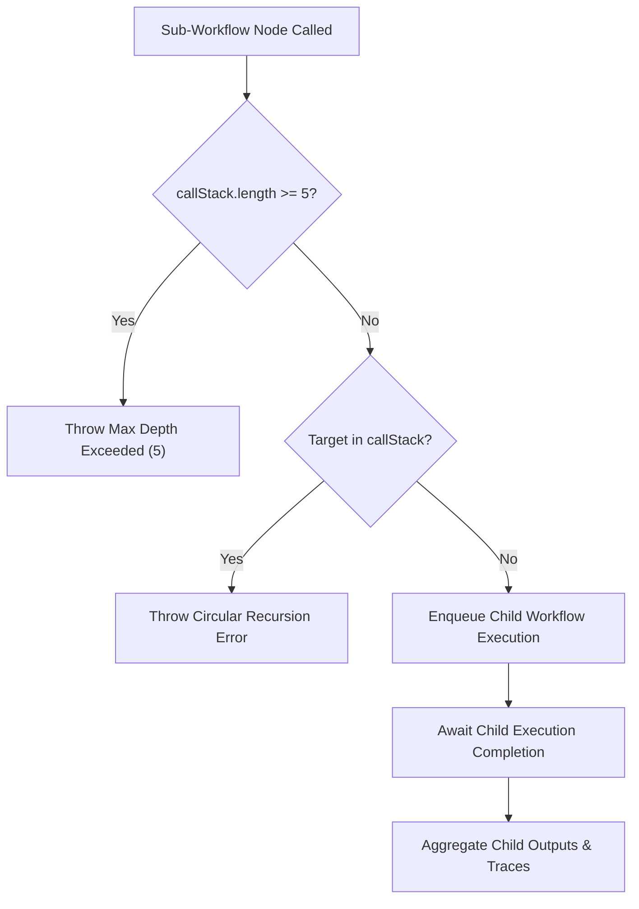

# FlowPilot Sub-Workflows & Modular Composition

## 1. Overview

Sub-workflows allow users to decompose complex enterprise automations into clean, reusable modules. A parent workflow can invoke one or more child workflows, pass typed input payloads, and receive output artifacts.

---

## 2. Guardrails & Safety Architecture



### 1. Depth Caps (`MAX_SUBWORKFLOW_DEPTH = 5`)
- Any workflow chain nested deeper than 5 calls is immediately halted with a descriptive runtime error.

### 2. Circular Recursion Prevention
- An immutable ancestor call stack array (`$callStack: string[]`) is propagated across execution boundaries.
- If a workflow attempts to invoke itself directly or indirectly via any ancestor currently in its call stack, the driver throws `Circular workflow recursion detected: wf_A -> wf_B -> wf_A` before enqueuing.

### 3. Context & Trace Aggregation
- Child execution IDs are tracked in the parent trace record.
- Node runtime driver: `src/core/runtime/drivers/subWorkflow.ts`.
- The parent node returns:
  ```json
  {
    "childExecutionId": "exec_sub_xyz",
    "status": "completed",
    "outputs": { ... },
    "durationMs": 420
  }
  ```
