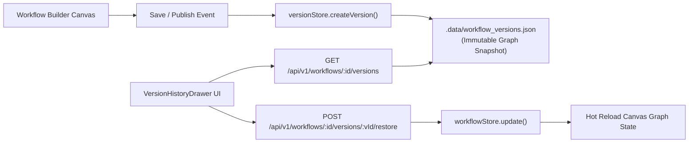

# FlowPilot Workflow Versioning & Snapshot System

## 1. Overview

FlowPilot incorporates an immutable snapshot versioning system for all visual workflows. Whenever a workflow is published, restored, or manually versioned, a deep-cloned snapshot is committed with sequential version numbers (`v1`, `v2`, ...), change descriptions, node counts, edge counts, and authorship metadata.

---

## 2. Architecture & Data Model



### Data Schema (`WorkflowVersion`):
```typescript
interface WorkflowVersion {
  id: string;               // ver_uuid
  workflowId: string;       // wf_uuid
  versionNumber: number;    // Sequential (1, 2, 3...)
  name: string;             // Snapshot label (e.g. "v2 - Added Loop Batching")
  description?: string;     // Change notes
  nodes: WorkflowNode[];    // Deep-cloned node graph
  edges: WorkflowEdge[];    // Deep-cloned edge connections
  createdAt: string;        // ISO timestamp
  createdBy: string;        // User or system
  triggerType: string;      // Root trigger type at time of snapshot
  nodeCount: number;        // Metadata
  edgeCount: number;        // Metadata
}
```

---

## 3. One-Click Rollback Mechanism

When a user selects "Restore" from the Version History drawer:
1. The target version snapshot is loaded from `versionStore`.
2. The current active workflow in `workflowStore` is overwritten with the cloned nodes and edges.
3. A new audit version record (`vN+1 - Restored from vK`) is automatically created to preserve a non-destructive audit trail.
4. The builder canvas state is dynamically updated without full page refresh.
